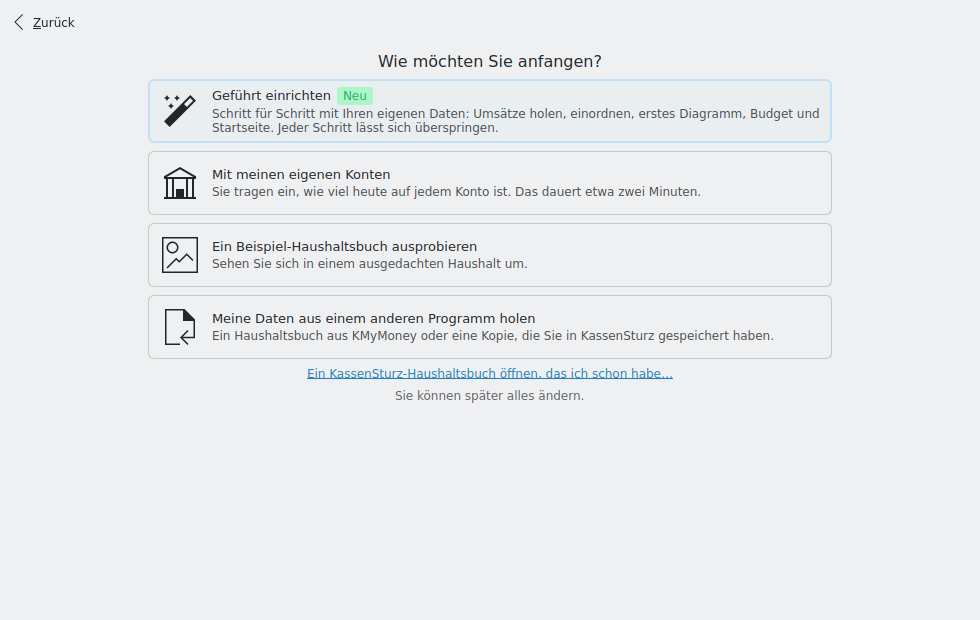
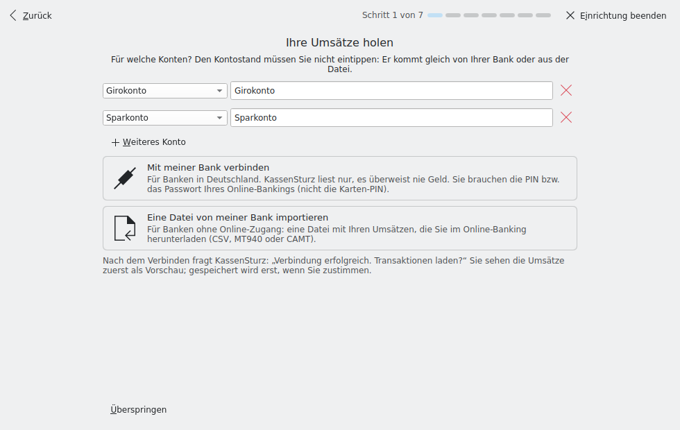
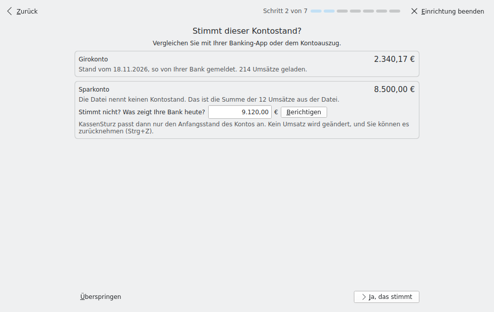
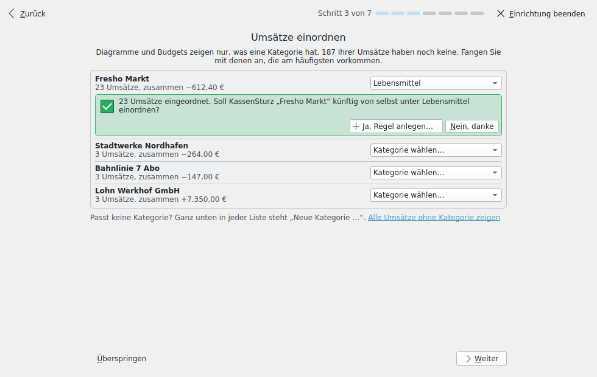
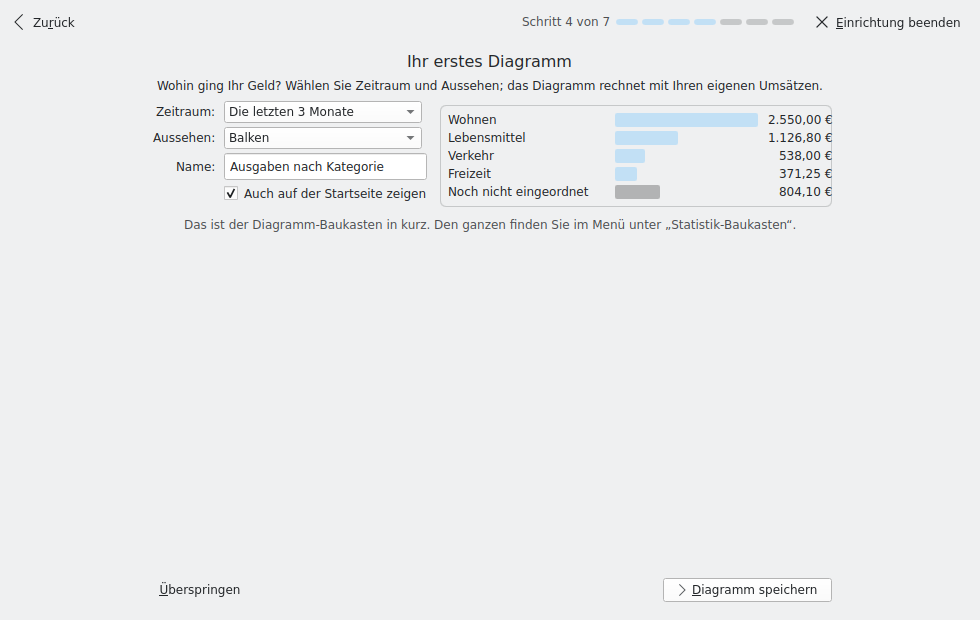
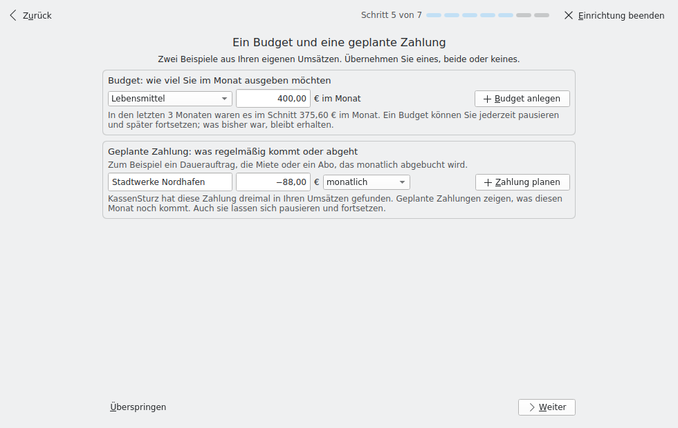
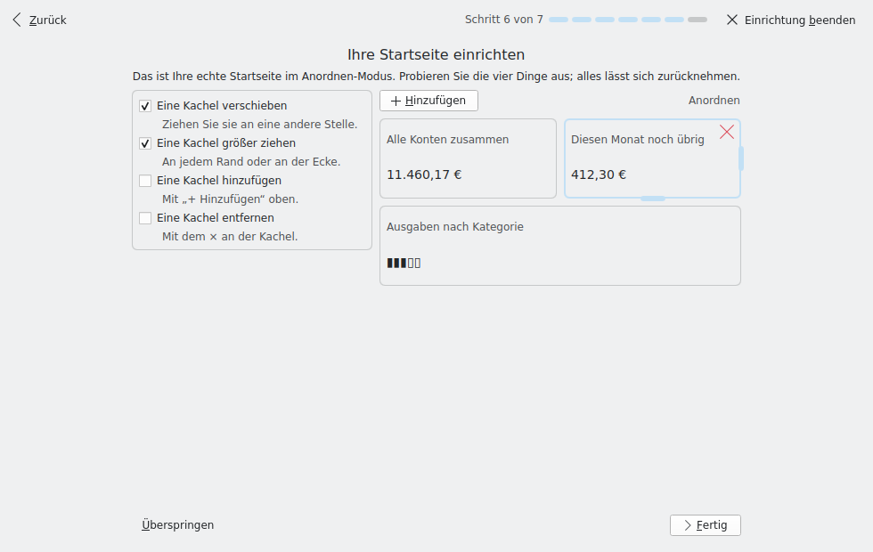
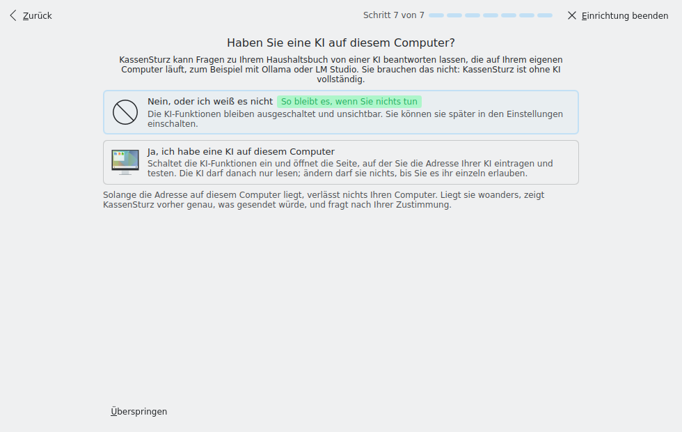
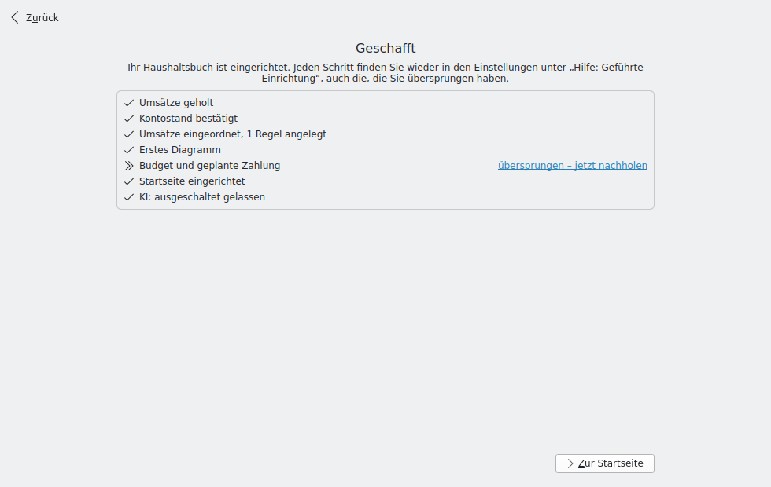

# Guided setup: design

Status: **built** (parts 1 to 3) (BS2, #1031; decided by Vondor in D-792, D-895 to D-902, D-911 and D-921 to D-923, and the 8-page sketch he approved on 19 Nov 2026). Made by Claude (Fable 5.2). The build follows in three pull requests (section 8); all three are built, and section 10 says where they differ from this design.

The guided setup is an **optional** walk through the important functions, on the person's own data. It extends the first setup wizard (`docs/SETUP_WIZARD.md`, M7a.9), which stays as it is: the guided setup is one more choice on its page 2. The pictures in `docs/setup-wizard/guided/` are simple QML mocks with made-up figures and invented names, in German because the testers are German; they show layout and wording, not final styling.

## 1. Goals and limits

- **Optional, never forced** (D-899). The start page keeps every choice it has today. "Guided setup" is one choice among them. A person who picks another choice never sees it.
- **Never in front of the overview** (D-342, D-792). Every page has **Skip**, and **End the setup** leads to the overview at once. The app is complete without the guided setup.
- **Offered once, for a new book** (D-898): only on the start page of a book that has no account yet. It never appears on a later import or a later start.
- **On the person's own data**, one thing per page, plain words (AGENTS.md §6). Figures on the pages come from the book through Rust as text (D-065); nothing is typed for the person and nothing is guessed.
- **Every step can be found again** in Help (D-902), also the skipped ones.
- **No format change.** The guided setup stores nothing of its own: no table, no column, no user action and no app setting. How far a person got is kept only while the app runs (section 5). So the Beta rule on migrations doesn't apply, and layout 37 stays the only format change of BS2 (D-893).
- **AI stays off unless chosen** (AGENTS.md §8, D-911). The last step asks; doing nothing leaves AI off and invisible.
- **Windows first among testers.** Nothing depends on Linux. The bank choice hides itself where the build has no bank support (D-054) or doesn't offer the bank in the wizard (Q-398, Q-562).

## 2. The flow

```
Start page (wizard page 2, unchanged choices)
   └── Guided setup  ◄── new, optional
         1 Get the transactions ─► bank setup or file import (existing pages)
         2 Is this balance right?
         3 Sort the transactions, offer a Rule
         4 Your first chart
         5 A budget and a planned payment
         6 Shape your start page
         7 Do you have an AI on this computer?
         Done ─► overview
```

Every step page has the same frame: **Back** (top left, Alt+Left), "Step n of 8" with a progress bar (the accounts page, step 1 of the sketch, is counted as its own page since B-422, so the count runs over 8 pages, 7 without the AI step), **End the setup** (top right), and a bottom row with **Skip** on the left and the page's one main button on the right. Skip does nothing but go to the next step. The sketch counts 8 pages: the start page plus these 7 steps; the closing page belongs to the last step.

### Page 1: How would you like to start? (`1-start.png`)



The existing `WizardStartPage.qml` with one more choice at the top, **Guided setup** (*Geführt einrichten*): "Step by step with your own data: get your transactions, sort them, a first chart, a budget and your start page. Every step can be skipped." The three other choices and the "Open a book I already have" link stay exactly as they are (D-899). Nothing is written here.

### Step 1: Get the transactions (`2-transactions.png`)



- **Which accounts:** the rows of the existing accounts page (kind and name, "+ Add another account"), **without the amount field**. With a bank or a file the balance comes from there (D-895), so nobody types it.
- **Connect to my bank** (D-896, D-897): the line under it carries the fixed sentence on which PIN is meant, the PIN or password of the online banking, not the card PIN (the wording of #1239). It opens the existing bank setup page unchanged. After a successful connection that page asks whether to load the transactions now (#1238), and the list before saving is labelled a preview. Shown only where the wizard offers the bank today (bank support in the build, and the `wizard-bank` build switch of Q-398 and Q-562).
- **Import a file from my bank** (D-911): for banks without online access. CSV, MT940 or CAMT (and OFX, which the importer also reads). It asks which account the file is for when there is more than one, then opens the existing import pages unchanged; their preview is already a preview.
- **What is written, and when:** choosing bank or file first creates the book in one user action, exactly as *Create my household book* does today (currency, default categories, the accounts), with empty starting balances. Then the existing pages save what they save today, each after its own confirmation.
- **Skip** here has no account to go on with, so it says so and leads to the existing accounts page with amounts ("My own accounts"); a book needs at least one account.

### Step 2: Is this balance right? (`3-balance.png`)



One box per account that got transactions (D-911).

- **From the bank or from a file that names a balance** (CAMT, MT940): the balance and its date as the bank stated them. After #1237 (D-903) the first fetch sets the starting balance so that the account ends on the bank's balance.
- **From a file without a balance** (CSV): the page says the file names none and that the figure is the sum of the file's transactions.
- **Yes, that's right** goes on. **Not right?** The person types what their bank shows today and presses *Correct*. This is the existing "Check against my bank" correction (`accounts::correct_starting_balance`, the user action `CorrectStartingBalance`, D-116, D-117): only the account's starting balance changes, no transaction is touched, and one Undo takes it back. The page says exactly that before the click.
- The amount is typed text, read and checked in Rust (D-065); a wrong amount shows its message under its own row.

### Step 3: Sort the transactions, offer a Rule (`4-sort.png`)



- The intro says why: charts and budgets only show what has a category (D-898, and the case of #1240, D-908), and how many transactions have none yet.
- The list groups the transactions without a category **by name**, the most frequent first, with how many there are and their sum. Each group has the normal category picker, which ends with "New category …" (#1244, D-910).
- Choosing a category sorts that group's transactions in **one user action** (one Undo), using the existing edit of a transaction's category.
- **The Rule offer** (D-911): after a group is sorted, a message under it asks whether KassenSturz should sort that name by itself in future. *Yes, make a Rule…* opens the existing Rule page, filled from one of the group's transactions (`ruleBook.formFromTransaction`, D-088), so the person sees and confirms the Rule. *No, thanks* closes the message.
- A link shows all transactions without a category in the normal list. The page never asks to sort everything; *Continue* is always enabled.
- When there is no transaction without a category, the page says so and offers only *Continue*.

### Step 4: Your first chart (`5-chart.png`)



One run of the Statistic Builder on the person's own data (D-900), shortened to what a first chart needs: "Spending by category" is preset; the person chooses the period and the look, sees the real preview, names it and saves. The page uses the existing builder object and chart view; the saved chart is a normal saved statistic. A tick, on by default, also puts it on the start page as a normal widget (D-452). Money without a category shows as "Not sorted yet", as in every chart. A line says where the full builder is.

### Step 5: A budget and a planned payment (`6-budget-plan.png`)



Two examples from the person's own transactions (D-901); each is saved only by its own button, and both can be left out.

- **Budget:** the category with the highest spending is preset, with its monthly average next to it as a figure from code (the average the charts already compute for spending). The amount field starts empty with that average as its hint, so the app proposes nothing as the person's wish. *Create budget* uses the existing budget save.
- **Planned payment:** worded so that people who look for it under other names find it: "for example a standing order (*Dauerauftrag*), the rent or a subscription that is taken monthly". When the import found a repeating payment (the existing "Planned payments found"), the first one is preset; otherwise the fields are empty. *Plan payment* uses the existing plan save.
- Both boxes say that a budget and a planned payment can be **paused and continued** later and that what was there before is kept (#1241, D-909), so the old "End" needs no explanation here.

### Step 6: Shape your start page (`7-start-page.png`)



The person's real overview in its normal arrange mode, with a small list of four things to try next to it (D-902, D-911): move a tile, make a tile larger by dragging any edge or the corner (#1243, D-905), add a tile, remove a tile. Each line ticks itself when the person has done it. The list is part of the guided setup's frame, not of the dashboard, so the dashboard keeps no fixed part (D-452). Everything is the normal layout editing with its normal Undo; *Done* leaves arrange mode as its own Done does. The list suggests removing the tile that was just added, so nobody loses a tile they wanted.

### Step 7: Do you have an AI on this computer? (`8-local-ai.png`)



- **No, or I don't know** is preselected and is also what Skip and End the setup do: the AI features stay off and invisible, and the page says where to turn them on later.
- **Yes, I have an AI on this computer** turns on the existing "AI features" switch and opens the existing "AI provider and privacy" page, where the address is typed and tested. Nothing else changes: the permission grid stays all off, and an address on another computer still needs the existing consent with its statement of what is sent (D-035).
- The page states that KassenSturz is complete without AI and names no vendor as a recommendation; the two programs in the text are examples of where a local model runs, as on the existing settings page.
- **A build without AI** (D-039) has no step 7; the count then says "of 7" (B-422: it counts the accounts page and the step after it separately; before, both said "1").
- This page is the one AI element, besides the Settings toggle, that is visible while AI is off, and only inside the optional guided setup (D-911). AGENTS.md §8 names the Settings toggle as the only such element (D-013), so the pull request that builds this page updates that sentence of §8 (D-923, section 9).

### Done (`9-done.png`)



A short list of the steps, each marked done or skipped; a skipped one has a link to do it now. One sentence says where every step is found again: the Help of the Settings page, **Help: guided setup**. *To the start page* shows the overview.

## 3. Help: every step again

Help is reached today from the end of the Settings page ("Help: patterns, formulas and charts"). A second button there, **Help: guided setup**, opens a new page that lists the seven steps with one line each; each opens the same page as in the guided setup, on the book that is open. From Help a step stands alone: its main button leads back to Help, and there is no step count. Step 1 from Help offers the bank setup and the file import for the accounts the book already has and creates nothing by itself.

## 4. What is reused

| Step | Existing part it uses | New |
|---|---|---|
| Page 1 | `WizardStartPage.qml` | one choice |
| 1 | the account rows of `WizardAccountsPage.qml`, the first-setup write (`FirstStart`), `BankSetupPage.qml` with #1238 and #1239, the import pages | the page; rows without amounts |
| 2 | `BankCheckPage.qml`'s correction (`CorrectStartingBalance`), the stated balance (D-117), #1237 | the page |
| 3 | the category picker with #1244, the Rule page and `formFromTransaction` | the page; a read-only bridge list of unsorted transactions grouped by name; sorting a group as one user action |
| 4 | the Statistic Builder's builder object, `ChartView`, saved statistics, the add-to-overview call | the page |
| 5 | `BudgetBook`'s save, the charts' monthly average, `PlannedPayments`' save, the import's "Planned payments found", #1241 | the page |
| 6 | `OverviewPage.qml` in arrange mode, #1243 | the list of four things and its ticks |
| 7 | the AI switch, `AiSettingsPage.qml` | the page |
| Help | the Help button of the Settings page | a second button and the page "Guided setup" |

No bank, keychain, money or layout code changes. Steps 1 and 2 only call what #1237, #1238 and #1239 built, which is why the build waits for them.

## 5. Leaving, skipping and coming back

- **Skip** goes to the next step and writes nothing. **End the setup** shows the overview. **Back** goes to the step before; what a step already saved stays saved and is taken back with Undo, as everywhere.
- **Nothing is half-made.** Each step saves through the existing actions, each complete in itself. Closing the window on any page leaves the book valid: what was confirmed is in it, the rest is not.
- **How far the person got is not stored** (section 1, no format change). After closing the app in the middle, the next start shows the overview, because the book has an account by then, and the remaining steps are in Help. The guided setup doesn't start again by itself: that would put it in front of the overview (D-342).
- **Test profile** (Q-399): a test uses a made-up book only, so the start page isn't shown there and the guided setup isn't offered at the start. The steps are reached through Help on the example book, with the fake bank and the tester kit's synthetic files.

## 6. Words

About 60 new strings, all through KI18n with German entries ("Sie", D-578). Fixed German wordings from the decisions are used as decided: "Verbindung erfolgreich. Transaktionen laden?" (D-906), "PIN bzw. Passwort Ihres Online-Bankings (nicht die Karten-PIN)" (D-907), "Stimmt dieser Kontostand?" (D-911), "Neue Kategorie …" (D-910), "Pausieren" and "Fortsetzen" (D-909), "Überspringen". New glossary entry: **Guided setup** (*Geführte Einrichtung*). Every example in the app, the tests and the docs uses invented names only (#734).

## 7. Everyday-user test, step by step

| Step | What a person must understand | Why they can |
|---|---|---|
| Page 1 | That the guided way is one choice of several | One sentence says what it does and that it can be skipped |
| 1 | Bank or file, and which PIN | Two choices in everyday words; the PIN sentence is on the choice itself |
| 2 | Whether the figure matches their bank | It is the figure their banking app shows; correcting needs only that figure |
| 3 | Which category a name belongs to | They know their own shops; one pick sorts all of that name |
| 4 | Period and look | Both preselected; the preview shows their own money |
| 5 | What they want to spend, and what repeats | The average and a found payment are shown; nothing is required |
| 6 | That tiles can be moved, resized, added and removed | Four things to try, each ticks itself |
| 7 | Whether they have an AI program | "No, or I don't know" is preselected and changes nothing |

## 8. The build: three pull requests

All three start after #1237 (thread F1) and #1238, #1239, #1244 and #1241 (thread G) have merged; step 6 also needs #1243.

1. **Start page choice, the frame, steps 1 and 2, the Help page.** No human gate: it calls the bank setup and the correction unchanged.
2. **Steps 3 to 6 and the Done page** (the Done page moved here with D-931). No human gate.
3. **Step 7.** Human gate: AI data sharing (the page turns on the AI switch). It also updates the sentence in AGENTS.md §8 (D-923).

Tests in each: every new bridge object read back the way QML reads it; seams with real output (a synthetic CAMT file through the real import into step 2; the fake bank's fetch into step 2 after #1237; a group sorted in step 3 read back from the real register and undone in one step; the chart of step 4 from the real builder; step 7 leaving the AI switch off on Skip, End and "No", checked in the settings file); the no-AI build without step 7; an action-log name for every handler; a screenshot of every built page on the pull request; German entries for every new string.

## 9. Points the maintainer decided

Asked through the coordinator; the maintainer took the recommended option of each (19 Nov 2026).

1. **Progress is not stored (D-921, Q-687).** It is kept only while the app runs, so there is no format change; the remaining steps are in Help. The other option was to remember it in the settings file, which would be a settings migration with backup and test (a human gate) for a small gain.
2. **Test profile (D-922, Q-688).** No guided choice at the start there; the steps are reached through Help on the example book. The other option was to offer the guided setup in the test profile on a new made-up book in the test folder.
3. **AGENTS.md §8 (D-923, Q-689).** That section names the Settings toggle as the only AI element visible while AI is off, and D-911 adds step 7. The gated third pull request changes the sentence to include the optional last step of the guided setup.
4. **The last page links to the wiki (D-931, Q-693, 20 Nov 2026).** "More help in the wiki", next to the hint that every step is found again under Help. The Done page therefore came with part 2; part 3 adds only step 7 in front of it.
5. **Steps 4 to 6 open the real screens (D-932, Q-694, 20 Nov 2026).** Each explains the feature in a sentence or two and opens the real function on the person's own book, as steps 1 and 2 do. The other option was small forms inside the wizard pages as in the mocks: closer to the pictures, but shortened copies of three screens that could drift from the real ones.

## 10. As built

What the build does differently from the sections above. The pictures in section 2 stay the design mocks.

### Part 1: start choice, frame, steps 1 and 2, Help page

- **Step 1 is two pages.** "Guided setup" first opens the existing accounts page in its guided form (`WizardAccountsPage.qml` with `guided`): kind and name only, no amount, no "More", titled "Which accounts do you have?". Its **Continue** creates the book in one user action, as "Create my household book" does, with every account empty. Then `GuidedTransactionsPage.qml` offers the bank and the file. So the book exists before a choice is made, and **Skip** on the second page simply goes on to step 2: the special case in section 2 ("Skip here has no account to go on with") isn't needed.
- **End the setup before the book exists** leads back to the start choices, not to the overview: there is no book to show yet. From the second page on it shows the overview.
- **The bank setup and the import are opened, not embedded.** They are the existing page and dialogs, unchanged, and closing them leads back to the step, where **Continue** goes on. No bank, keychain or import code is touched.
- **Step 2 shows every open account of the book**, not only those that got transactions, each with its balance today and, where the bank stated one, whether that matches. A figure typed under "Not right?" is handed to the existing "Check against my bank" page (`BankCheckPage.qml`), which shows the difference and offers the correction (`CorrectStartingBalance`); the guided page corrects nothing itself. The button therefore reads **Compare…**, not *Correct*. A line for "the file names no balance" isn't shown: the account then has no stated balance and the page shows only what KassenSturz has.
- **The step count names the steps that are built**, "Step 1 of 2" for now, and the line under "Guided setup" on the start page lists only those. Both grow with parts 2 and 3. The Help page lists the two built steps.
- **Frame:** `GuidedBar.qml` (step count, progress, "End the setup") is each step's header, `GuidedFooter.qml` ("Skip" and the main button) its footer. A step opened from Help has no bar and no "Skip", and its main button reads **Done**.
- **Pictures of the built pages** (German, on stand-in data with made-up figures, so the account kinds read English there): [start page](setup-wizard/guided/built-1-start.png), [step 1, accounts](setup-wizard/guided/built-2-accounts.png), [step 1, transactions](setup-wizard/guided/built-3-transactions.png), [step 2](setup-wizard/guided/built-4-balance.png), [Help page](setup-wizard/guided/built-5-help.png).
- **Tests:** `qml-tests/GuidedSmoke.qml` builds the start page, both forms of step 1, step 2 and the Help page against stand-ins and checks their buttons and signals.

### Part 2: steps 3 to 6 and the Done page

- **Step 3** (`GuidedSortPage.qml`, `guided_sort.rs`): one box per name with how many transactions it has and their sum, the 12 largest groups first; sorting one lets the next show. A group holds the simple transactions of one name, one direction and one currency; a transaction that is already broken down into parts, or in two currencies, stays with its own page. Choosing a category sorts the group at once, without a second click: it is one change, the notice at the bottom offers Undo, and the page says so. It is recorded as the edit of a transaction, so the book gets no new kind of change. The Rule offer shows above the list (the sorted group is gone from it) and opens the Rule page filled from the group's newest transaction. There is no link to "all transactions without a category": the app has no such list to open, and the page refills by itself.
- **Steps 4 to 6 open the real screens (D-932)** from one page each (`GuidedTryPage.qml`): the Statistic Builder with "Spending by category" chosen; the normal budget page and the planned-payment dialog; the overview in its arrange mode. So step 4 has no period and look of its own and no tick for the start page (the builder's own "add to the overview" does that), step 5 presets no category and shows no average, and step 6 lists the four things to try as text instead of a list that ticks itself. Closing the opened screen leads back to the step.
- **Done page (D-931):** the same page type, without a step count. It says where the steps are found again and offers "More help in the wiki", which opens the handbook in the web browser (`Qt.openUrlExternally`, as the project link in Settings does); the app itself makes no connection. Its button leads to the overview. Until part 3, step 6 leads straight to it.
- **Step count and Help:** "Step n of 6" until part 3; the Help page lists all six.
- **Pictures of the built pages** (German, stand-in data with made-up figures and invented names): [step 3](setup-wizard/guided/built-6-sort.png), [step 4](setup-wizard/guided/built-7-chart.png), [step 5](setup-wizard/guided/built-8-budget-plan.png), [step 6](setup-wizard/guided/built-9-start-page.png), [Done](setup-wizard/guided/built-10-done.png), [Help page](setup-wizard/guided/built-5-help.png).
- **Tests:** `guided_sort.rs` (groups by name with exact sums; sorting a group is one change that one Undo takes back, made through the real transaction entry; a group or category that isn't there is refused), `guided_sort_model.rs` (the object read back as QML reads it), `qml-tests/GuidedSortSmoke.qml` and `qml-tests/GuidedSmoke.qml` (steps 4 to 6 and the Done page).

### Part 3: step 7, a local AI or not (human gate)

- **Step 7** (`GuidedAiPage.qml`) is the last step, in front of the Done page. Its two choices show what holds now: **No, or I don't know** while AI is off, marked "This is how it stays if you do nothing". **Skip**, **Continue** and **End the setup** never touch the switch, and neither does clicking "No" while AI is off.
- **Yes** turns on the one AI switch (`AiSwitch.switchTo`, the same call as the toggle in Settings, D-013) and opens the existing "AI provider and privacy" page on top, so closing it leads back to the step. Nothing else is written: no address, no consent and no permission. Clicking **No** afterwards turns the switch off again. A choice that can't be saved says so and opens nothing.
- **The line under "Yes" differs from the mock.** The mock said the AI may only read after that. In the app every permission starts switched off, reading too, so the page says that the AI reads and changes nothing until the person allows it, one thing at a time.
- **Where it shows:** only in a build that has AI and outside the test profile (`AiSwitch.available`, D-039, D-922). There the guided setup has seven steps and its Help page a seventh entry; otherwise it has six and no trace of the question. AGENTS.md §8 names the question next to the Settings toggle (D-923), and the audit `ai_audit.rs` allows the word "AI" only in this page and in the marked Help entry, checks that both hide where AI is not available, and that only "Yes" turns AI on.
- **The choice card** of steps 4 to 7 is one component now, `GuidedChoice.qml`, with a mark for the choice that holds.
- **Pictures of the built pages** (German): [step 7](setup-wizard/guided/built-11-local-ai.png), [Help page](setup-wizard/guided/built-5-help.png).
- **Tests:** `qml-tests/GuidedAiSmoke.qml` (No holds; Skip, Continue, End and No leave the switch alone; Yes turns it on and asks for the provider page; No takes it back; a choice that isn't saved says so; Help lists the step only where AI is in the build) and the audit above. That the switch stays off in the settings file until it is written, and that a build without AI never writes it, are the existing tests of `ai_switch_model.rs`.
