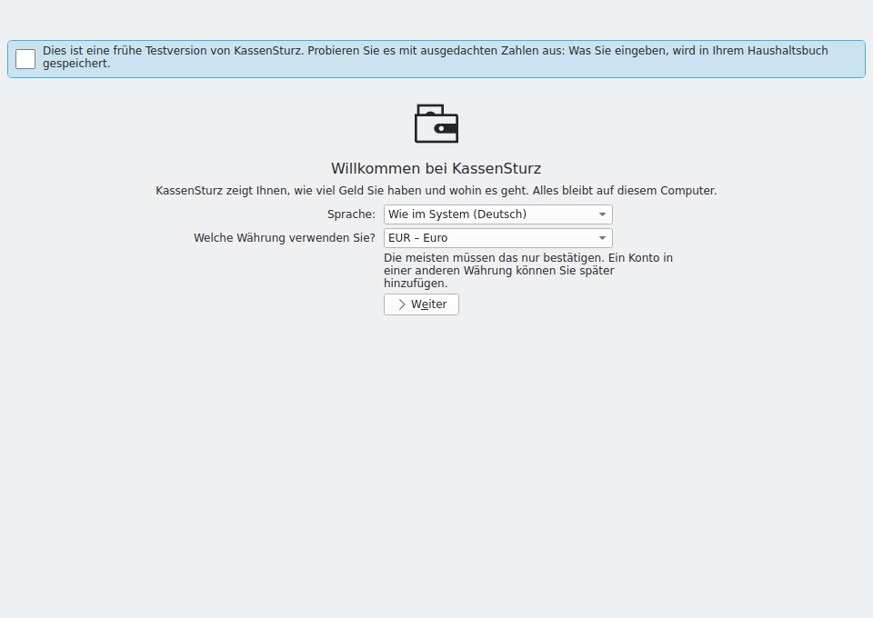
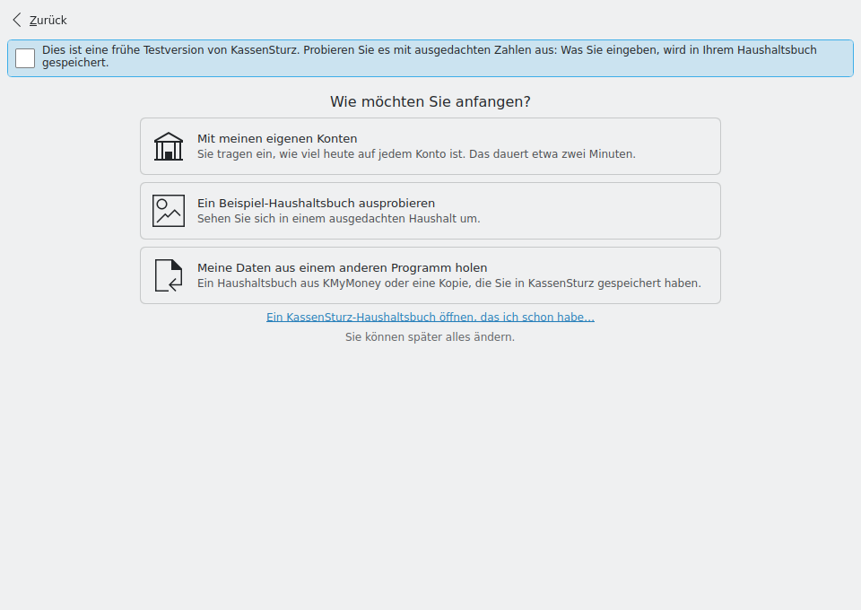
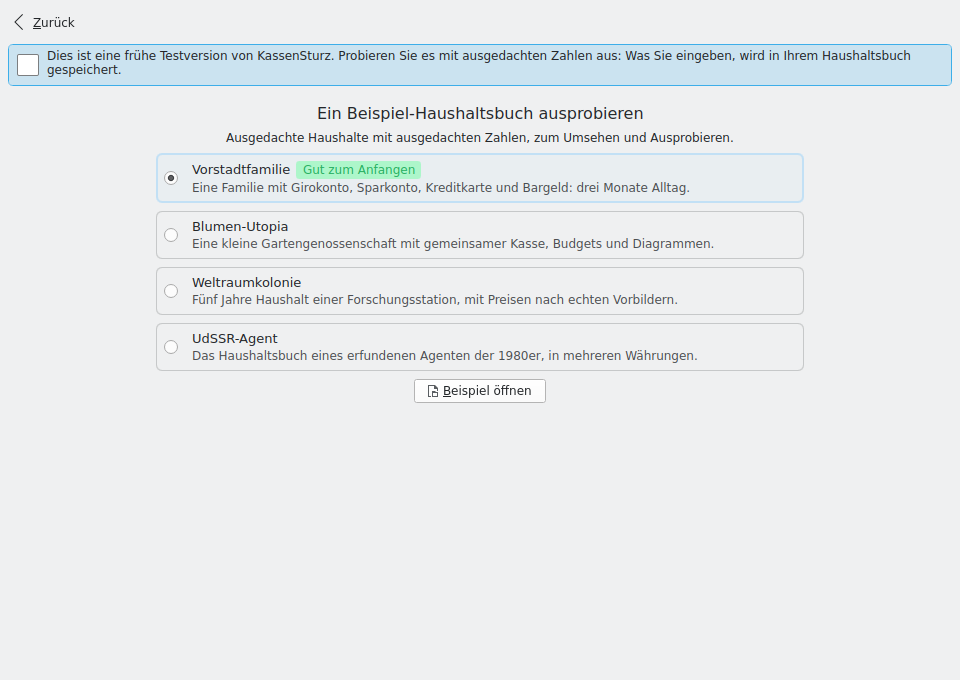
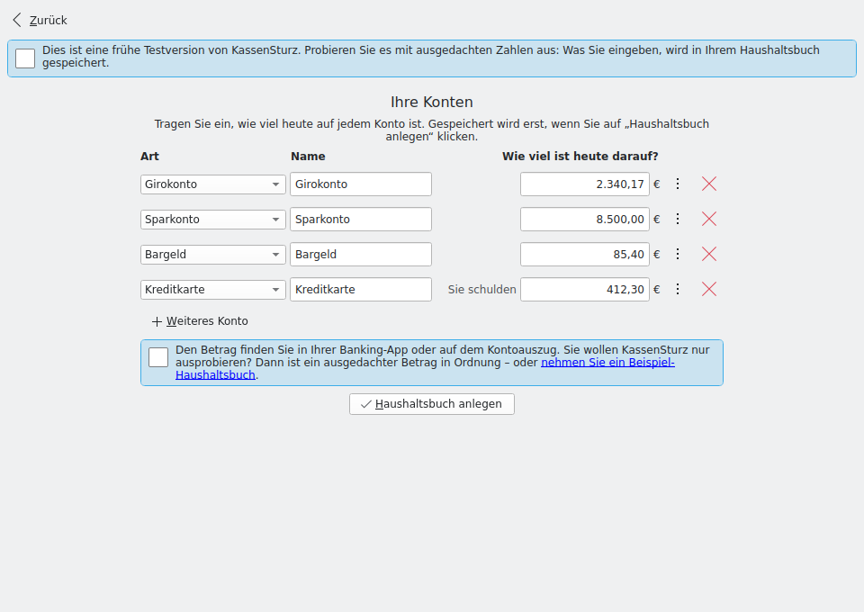
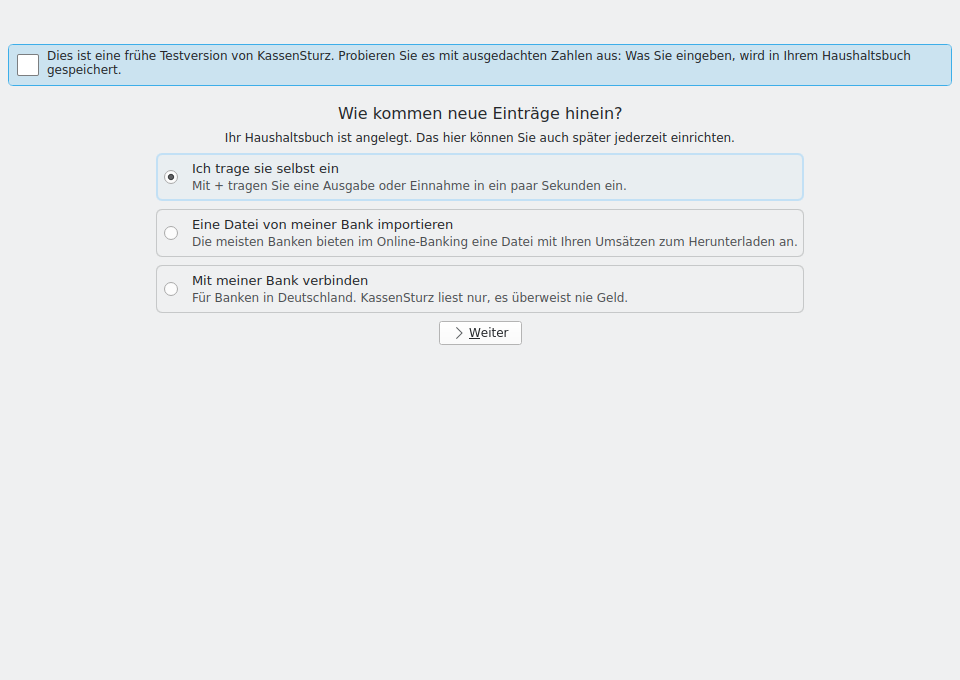
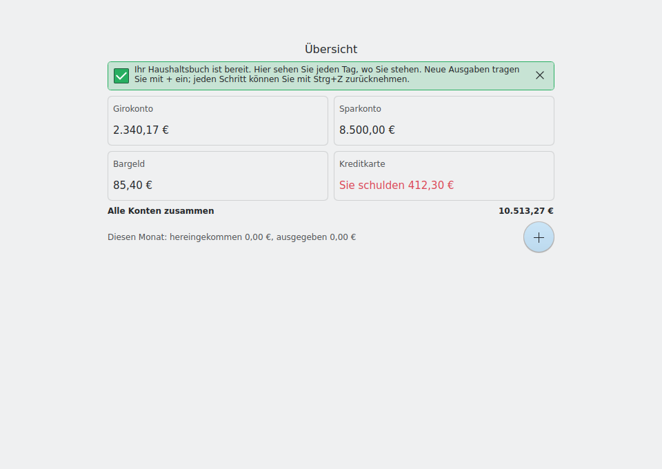

# First setup wizard: design

Status: **design for review** (M7a.9, part 1; roadmap row "First setup wizard", D-540). Nothing here is built yet. The build starts only after the maintainer approves this design; the decisions it makes are recorded as D-543 to D-547 when the build merges.

The wizard is what a new person sees the first time KassenSturz opens a book that has no account yet. It replaces the M3.4 first-run steps (welcome page, first account, first transaction; D-111, D-116) with a short guided flow that ends on the overview, which is the product (D-342). The mock screenshots in `docs/setup-wizard/` are simple QML mocks with made-up figures, rendered under Xvfb in German, because the first testers are German; they show layout and wording, not final styling.

## 1. Goals and limits

- **Three clicks to a useful overview.** A person who accepts every default reaches the overview with one account after: *Continue* → *My own accounts* → *Create my household book*.
- **Plain words only** (AGENTS.md §6). No "double-entry", "opening balance", "ledger", "category tree" or "chart of accounts". Every page passes the everyday-user test: someone with no finance background answers it correctly on the first try.
- **No half-made books.** Nothing is written into the book until the user finishes a step. Closing the window halfway leaves the book exactly as it was, and the wizard starts again next time.
- **AI stays off and invisible** (AGENTS.md §8, D-013). No page mentions AI; the wizard never turns it on.
- **No layout change.** The wizard uses the book's existing tables and user actions and no new app setting (section 7). The Beta rule that a layout or settings change is a migration with backup and test therefore doesn't apply.
- **Windows first among testers.** Nothing in the flow depends on Linux; the bank option hides itself where the build has no bank support (D-054).

## 2. The flow

```
1 Welcome: language and currency
        │
2 How would you like to start?
   ├── Try an example book ─────────► 3a Example book chooser (M7a.2) ─► overview of the example book
   ├── My own accounts ─────────────► 3b Your accounts ─► 4 How do new entries get in? ─► 5 overview, first look
   │                                                         ├── I'll type them myself
   │                                                         ├── Import a file from my bank ─► existing import pages
   │                                                         └── Connect to my bank ─► existing bank setup page
   └── Bring my data from another program ─► 3c existing "Start a book from a file" pages ─► overview
   (small link) Open a KassenSturz book I already have ─► file dialog
```

Every page has **Back** (top left, and Alt+Left). Only the marked buttons write anything (section 4).

### Page 1: Welcome (`1-welcome.png`)



- Heading "Welcome to KassenSturz", the existing one-line promise ("KassenSturz shows you how much money you have and where it goes. Everything stays on this computer.").
- **Language:** "As in your system (Deutsch)", "English", "Deutsch", each named in itself (D-127). The system's language is preselected, so a German Windows user only confirms.
- **Currency:** "Which currency do you use?", the regional settings' currency first, otherwise the euro (D-111), with the existing hint "Most people only need to confirm this. You can add an account in another currency later." Hidden when the book already has categories (D-116's rule stays).
- One button: **Continue**.
- **Changing the language** saves the existing `Language` setting (D-127) and, on *Continue*, restarts KassenSturz in the new language straight into this page. D-127 avoids a restart because of unsaved typing; here nothing has been typed yet, so the restart loses nothing. The page says so before the click: "KassenSturz starts again in English. Nothing is lost." (open question Q-395).

### Page 2: How would you like to start? (`2-start.png`)



Three large choices of equal weight, each with one line under it:

| Choice | Line under it |
|---|---|
| **My own accounts** | Type how much is in each account today. Takes about two minutes. |
| **Try an example book** | Look around in a made-up household. |
| **Bring my data from another program** | A KMyMoney book, or a copy you saved from KassenSturz. |

Below them a small link, **Open a KassenSturz book I already have…**, for someone whose book is on another drive or came from another computer. The footer says "You can change everything later." Which choice comes first is open question Q-396.

### Page 3a: Example book (`3a-examples.png`)



This page *is* M7a.2's chooser component, placed by the wizard; M7a.2 owns the component and its bridge call, the wizard owns the page around it and what happens after.

- The four books, each with a one-line description in the UI language: **Suburban Family** (marked "Good to start with" and preselected), **Flower Utopia**, **Space Colony**, **UdSSR Government Agent**. Their German names come from M7a.8.
- **Open example** fills the open, still empty book with the chosen example through the existing importer, in one go, and shows its overview. The bundled originals stay untouched. There is no separate copy and no "your own book" next to it: in a test, the example *is* the book (Q-399).

### Page 3b: Your accounts (`3b-accounts.png`)



The heart of the wizard. One list of rows, starting with one row; nothing is saved while the user types.

- Each row: **kind** (Checking account, Savings account, Cash, Credit card, each with its existing one-line hint from `AccountTypes.qml`), **name** (defaults to the kind's name), and **how much is in it today** (for a credit card: "How much do you owe on it today?"). Empty means nothing is in it (D-089). A row can be removed with ×.
- **+ Add another account** adds a row, preset to the next kind not yet used (savings, then cash, then credit card), so a typical household is three clicks plus amounts.
- **The balance hint**, under the list: "You find the amount in your banking app or on your statement. Just trying KassenSturz out? A made-up amount is fine, or try an example book instead." The last words are a link to page 3a. This is the consultant's catch from the M7a plan: the first start must not make anyone type their real balance to look around.
- **A deliberate step away** per row (a "More" toggle): another day than today ("On which day?", D-111) and another currency than the household's. Hidden by default.
- Amounts are typed text, read and checked in Rust as today (D-065, D-089): a wrong amount shows its message under its own row, with an example of the right form, while typing; nothing is rounded.
- **Create my household book** writes everything at once (section 4) and leads to page 4. While any row has an error the button explains which row instead of doing nothing.

Plain-language check: no row asks for anything a person can't read off their banking app or wallet.

### Page 3c: Bring my data from another program

No new page: the wizard opens the existing file dialog and the existing "Start a book from a file" pages (M3.12, `BookFromFilePage.qml`, `BookFromFileDonePage.qml`) unchanged. They already fill the open book only if it is empty and leave nothing behind when a file is refused. Their done page leads to the overview. A bank statement file chosen here gets the existing hint that statements go into an account, with a button back to page 2.

### Page 4: How do new entries get in? (`4-entries.png`)



Shown once, right after page 3b created the book; the book is already complete, so this page only offers what comes next.

| Choice | What happens |
|---|---|
| **I'll type them myself** (preselected) | Goes to the overview. |
| **Import a file from my bank** | Asks which account the file is for (only when there is more than one), then the existing import pages (M3.10) unchanged. |
| **Connect to my bank** ("For banks in Germany. KassenSturz only reads, it never sends money.") | The existing bank setup page (M4.6) unchanged; it links the bank's accounts to the ones just created. Hidden where the build has no bank support, and **hidden in every build until the maintainer has tested the bank flow in the finished app himself (Q-398)**: a build option, off by default, switches it on (section 7). |

### Page 5: The first look at the overview (`5-overview.png`)



The real overview, with one dismissible message at the top, shown only in the session in which the book was created: "Your household book is ready. This page shows you every day where you stand. Add a new expense with +; every step can be taken back with Ctrl+Z." Because it is tied to the session, it needs no stored "seen" flag. The side menu appears from here on, as today (D-116).

## 3. What is reused and what is replaced

| Today (M3.4, D-089, D-116) | In the wizard |
|---|---|
| `WelcomePage.qml`: currency and "Add your first account", plus the KMyMoney button | Rewritten as page 1 (language and currency); its two buttons move to page 2. The file stays, owned by M7a.9. |
| `DefaultCategories.qml` and the default set (D-116) | Reused unchanged; written on *Create my household book* (or when another start path needs them, as today). |
| `FirstStart` bridge object (`needsCurrency`, `currencies`, `hasAccount`) | Reused. `start()` is replaced by one call that writes categories and accounts together (section 4). |
| `NewAccountPage.qml` in first-run mode ("Your first account") | Its fields and checks become the row of page 3b. The page stays for "Add an account" from the screens; its `firstRun` mode goes. |
| The first transaction page (D-089, D-116: optional, skippable) | **Dropped from the first start** (open question Q-397). The first look points to +. |
| `BookFromFilePage.qml`, `BookFromFileDonePage.qml` | Reused unchanged as path 3c. |
| Import pages (M3.10), `BankSetupPage.qml` (M4.6) | Reused unchanged from page 4. |
| `MockNotice.qml` (the test-version banner) | Kept on every wizard page while KassenSturz is in test versions. |
| The first-run mock's look (`first-run-mock/*.png`) | One centred column, large icon, one main button per page: kept. |

## 4. Leaving, skipping and coming back

**What is written, and when.**

| Moment | What is saved |
|---|---|
| Page 1, a different language | Only the existing app setting `Language` (D-127), then the restart. The book is untouched. |
| Page 3a, *Open example* | The chosen example, written into the open empty book in one go, as the existing "Start a book from a file" pages do. |
| Page 3b, *Create my household book* | In **one user action** (`Book::as_one_action`): the currency, the default categories, every account and its starting balance. Either all of it is in the book or none of it. One undo takes the whole first setup back, and the wizard shows again. |
| Path 3c | What the existing "Start a book from a file" pages save today, all at once, and only after the user confirms. |
| Page 4 choices | What the existing import and bank pages save, each after its own confirmation. |

**Leaving.** Closing the window on any page before a saving click leaves the book as it was. Because the book still has no account, the next start shows the wizard again at page 1, with the language already set.

**Skipping.** There is no "skip" that leaves the user on an empty overview: an empty overview tells a new person nothing. The shortest way through is the three-click path in section 1. Page 4 and the first-look message are the only optional parts, and each is one click away from the overview.

**Coming back.**
- A second household: Settings › **Start a new book…** makes a new, empty book, and every empty book opens with the wizard.
- A book started in the wizard can always be extended later from the normal screens (accounts, import, bank); nothing the wizard does is only possible there.

## 5. Words

The wizard reuses the existing translated strings where they fit (account kinds and hints, the currency question, the balance hint) and adds about 30 new ones, all through KI18n with German entries. New terms checked against `docs/GLOSSARY.md`: "household book" (*Haushaltsbuch*, as the app already calls a book in German) and "example book" (*Beispiel-Haushaltsbuch*). The German form is "Sie", as in the rest of the app.

## 6. Everyday-user test, page by page

| Page | What a person must understand | Why they can |
|---|---|---|
| 1 | Their language and their currency | Both preselected from the system; confirming is enough |
| 2 | Whether they want to try or start for real | Three sentences in everyday words; "you can change everything later" |
| 3a | Pick one made-up household | One line per book, one marked as the place to start |
| 3b | Which accounts they have and what is in them | The kinds are things everyone owns; the amount comes from their banking app or wallet, and a made-up one is allowed |
| 4 | How entries get in from now on | "Type them myself" is preselected and always works |
| 5 | Where they stand | The overview; one message says what to do next |

## 7. What the wizard needs from core and store

No new table, column, user action or app setting:

- **Core and store:** unchanged. Writing the first setup uses `Book::as_one_action` with the existing `AddAccount` action, nesting the existing calls for the currency, the categories (as `FirstStart.start` does now), each account and its starting balance (as `NewAccountPage` does now). The change history therefore names the first setup by its first account; the entries inside it are the same ones the M3.4 flow writes.
- **Bridge (`kassensturz-ui-bridge`):** one new invokable on `FirstStart` that takes the currency, the category set from `DefaultCategories.qml` and the list of account rows as text, checks every row first (the existing amount and date parsing, D-065) and returns per-row error codes or writes it all. One invokable that restarts the app in the chosen language (`QProcess::startDetached` on the app's own executable, then quit; to be checked inside the Flatpak and on Windows). The bank option reads the existing bank `Status`, and it appears only in a build made with a new CMake option (for example `KASSENSTURZ_WIZARD_BANK`, **off by default**; Q-398). The option is a build switch, not an app setting, so it changes no settings layout. It is switched on only in a pull request after the maintainer has tested the bank flow in the finished app on his own machine and signed it off. Bank connections stay reachable from Settings as today; only the wizard's offer is gated.
- **QML:** new pages in `qml/` (one file per page, owned by M7a.9), `WelcomePage.qml` rewritten, `Main.qml`'s first-run routing pointed at the wizard. M7a.2's chooser is placed as page 3a.
- **Tests (part 2):** the new bridge call read back the way QML reads it; the all-or-nothing write (a row with an error writes nothing); seams with real output: page 3c runs the real importer on a synthetic KMyMoney sample, page 3a the real chooser on a bundled example book, page 4 a synthetic CAMT file through the real import; an Xvfb screenshot of every real page on the PR, and the click path in the testing guide.

## 8. Open questions for the maintainer

Asked one at a time in the project chat. Answers so far: **Q-395, Q-396 and Q-397 as recommended (R); Q-398 as recommended plus a gate** (the wizard's bank offer stays switched off until the maintainer has tested the bank flow in the finished app himself); **Q-399 option B** (the example becomes the book). All five are answered.

- **Q-395 Language change on page 1.** R: restart KassenSturz by itself on *Continue*, since nothing has been typed yet. B: keep D-127's behaviour ("applies the next time you start"), which leaves the rest of the wizard in the old language. C: no language choice in the wizard; Settings only.
- **Q-396 Order on page 2.** R: "My own accounts" first, the example book second, all three of equal size. B: the example book first, since every tester starts there. C: the example book as the one large button, the others smaller.
- **Q-397 The first transaction page.** R: drop it from the first start; the first look points to +. B: keep it as an optional page after page 4.
- **Q-398 Bank in the wizard.** R: offer *Connect to my bank* only after the accounts exist (page 4), reusing the bank setup page unchanged, so this step touches no bank code and stays free of a human gate. B: let a bank connection create the accounts and take their balances from the bank, which saves typing but is new bank code (a human gate, later than M7a).
- **Q-399 Example books and the user's own book.** Answered: the example simply becomes the book (option B); a test has no separate "own" data, so there is no copy and no banner.
