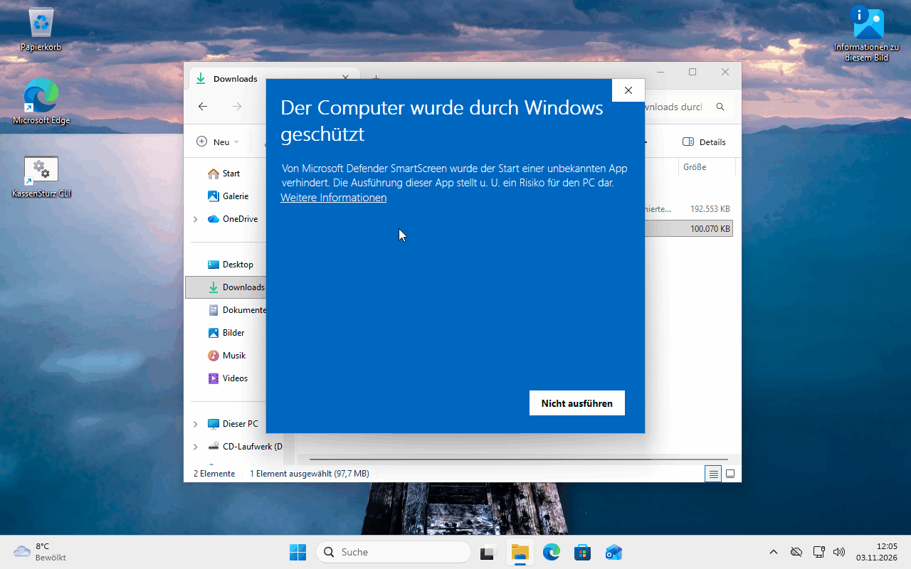

# 2. Installieren und aktualisieren

*Diese Seite sagt, welche Datei Sie laden, und verweist auf die Blätter mit allen Klicks. Ihre Haushaltsbücher bleiben bei jeder neuen Version erhalten.*

## Wo Sie KassenSturz bekommen

Öffnen Sie im Browser **https://github.com/Vondor/KassenSturz/releases**. Ein GitHub-Konto brauchen Sie nicht. Die oberste Version ist die neueste. Solange KassenSturz im Test ist, steht auf der Karte **Pre-release** (Testversion); das ist richtig so.

Unter **Assets** laden Sie genau eine Datei:

| Ihr System | Die Datei | Das Blatt mit allen Klicks |
|---|---|---|
| **Windows** (Installer, empfohlen) | endet auf `-windows-x64-setup.exe` | [Installationsblatt Windows](../../testing/INSTALL_WINDOWS.de.md) |
| **Windows** (ohne Installation) | endet auf `-windows-x64.zip`; Sie entpacken sie und starten das Programm daraus | im selben Blatt |
| **Ubuntu** und andere Linux-Systeme | endet auf `.flatpak` | [Installationsblatt Ubuntu](../../testing/INSTALL_UBUNTU.de.md) |

Nicht gebraucht werden *Source code (zip)* und *Source code (tar.gz)*; die sind für Entwickler.

## Windows warnt, was nun?

Bei einer Testversion meldet Windows einmal „Der Computer wurde durch Windows geschützt“. Das Blatt zeigt Schritt für Schritt, wie Sie die Meldung bestätigen. Der Installer richtet KassenSturz nur für Ihr Benutzerkonto ein; Administrator-Rechte brauchen Sie normalerweise nicht.

## Aktualisieren

Eine neuere Version installieren Sie einfach **über die alte**, auf demselben Weg wie die erste:

- Unter Windows startet der Installer und ersetzt das Programm. Läuft KassenSturz noch, bittet er Sie, es zu schließen.
- Unter Ubuntu: `flatpak install --user --reinstall` mit der neuen Datei (Befehl im Blatt).

**Ihre Haushaltsbücher werden nicht angefasst.** Bevor KassenSturz ein Buch an eine neue Version anpasst, legt es selbst eine Sicherung an (**Einstellungen › Sicherungen**) und behält die letzten zehn.

> **Hinweis für die Testzeit:** Bücher aus älteren Entwicklungsversionen öffnen sich unter Umständen nicht in neueren. Speichern Sie vor einer Aktualisierung das ganze Buch (Seite 17).

## Entfernen

Windows: wie jedes Programm unter **Einstellungen › Apps**. Ubuntu: `flatpak uninstall --user io.github.vondor.KassenSturz`. Ihre Haushaltsbücher bleiben dabei liegen, bis Sie sie selbst löschen.

**Wenn etwas anders aussieht:** Kommen Sie an einer Stelle nicht weiter, folgt das Installationsblatt Ihres Systems Schritt für Schritt; dort steht auch, wie Sie ein Protokoll zum Weitergeben erzeugen.
