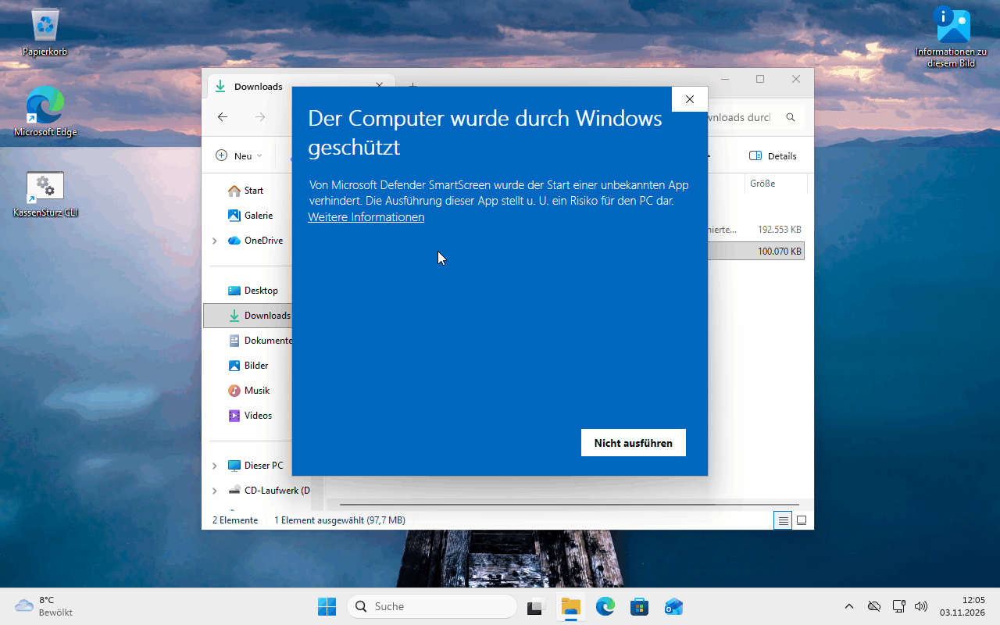

# 2. Installieren und aktualisieren

*Diese Seite sagt, wo Sie KassenSturz für Ihr System bekommen und wie Sie es aktualisieren. Ihre Haushaltsbücher bleiben bei jeder neuen Version erhalten.*

## Windows: aus dem Microsoft Store (empfohlen)

Öffnen Sie **https://apps.microsoft.com/detail/9NM5V48PPRLQ** und klicken Sie auf **Herunterladen** (oder **Installieren**). Der Store installiert KassenSturz und aktualisiert es später selbst. Windows zeigt keine Warnung, weil der Store das Programm prüft und signiert.

## Linux: aus dem Snap Store (empfohlen)

Öffnen Sie ein Terminal, also ein Fenster, in das Sie Befehle tippen (unter Ubuntu und Kubuntu: Strg+Alt+T drücken). Tippen Sie diese Zeile und drücken Sie die Eingabetaste; sie fragt einmal nach Ihrem Passwort, und beim Tippen des Passworts erscheint nichts:

```sh
sudo snap install kassensturz
```

Starten Sie danach **KassenSturz** aus dem Anwendungsmenü. Der Store installiert die stabile Ausgabe und aktualisiert sie später selbst. Einiges ist im Snap ausgeschaltet, bis Sie es erlauben, zum Beispiel das Speichern Ihrer Banking-PIN im Passwortspeicher; [die Installationsseite des Projekts](../../INSTALL.de.md) nennt alles mit dem jeweiligen Befehl.

## Stabil und Beta

- Die **stabile** Ausgabe ist die für den Alltag, mit Ihrem eigenen Haushaltsbuch. Eine eigene Kopie von Zeit zu Zeit bleibt trotzdem klug (Seite 17).
- Eine **Beta**-Ausgabe ist neuer und kann mehr Fehler haben. Sie ist zum Ausprobieren da; nehmen Sie dort ein Beispielbuch oder eine Kopie Ihres Buchs. Aus dem Snap Store bekommen Sie sie mit `sudo snap install kassensturz --beta`.

KassenSturz als Ganzes ist noch in der Beta-Phase: Bis Version 1.0 beginnt jede Versionsnummer mit `0.`.

## Andere Wege: die Release-Seite

Öffnen Sie im Browser **https://github.com/Vondor/KassenSturz/releases**. Ein GitHub-Konto brauchen Sie nicht. Nehmen Sie die Ausgabe mit der Marke **Latest**: Das ist die stabile. Ausgaben mit der Marke **Pre-release** sind Beta-Ausgaben.

Unter **Assets** laden Sie genau eine Datei:

| Ihr System | Die Datei | Mehr Hilfe |
|---|---|---|
| **Windows** (Installer, wenn Sie den Store nicht nutzen) | endet auf `-windows-x64-setup.exe` | [Installationsblatt Windows](../../testing/INSTALL_WINDOWS.de.md), für Testsitzungen geschrieben, mit allen Klicks |
| **Windows** (ohne Installation) | endet auf `-windows-x64.zip`; Sie entpacken sie und starten das Programm daraus | im selben Blatt |
| **Linux** (wenn Sie den Snap Store nicht nutzen) | endet auf `.flatpak` | [die Installationsseite des Projekts](../../INSTALL.de.md) hat die drei Befehle |
| **Mac** mit Apple-Chip (experimentell, niemand hat es auf einem echten Mac getestet) | endet auf `-macos-arm64-experimental.dmg` | [KassenSturz unter macOS](../../MACOS.de.md) |

Nicht gebraucht werden *Source code (zip)* und *Source code (tar.gz)*; die sind für Entwickler.

## Windows warnt, was nun?

Das passiert nur mit den Dateien von der Release-Seite, nicht mit dem Store. Der Installer und die Zip-Datei sind nicht signiert, deshalb meldet Windows einmal „Der Computer wurde durch Windows geschützt“. Das Blatt zeigt Schritt für Schritt, wie Sie die Meldung bestätigen. Der Installer richtet KassenSturz nur für Ihr Benutzerkonto ein; Administrator-Rechte brauchen Sie normalerweise nicht.



## Aktualisieren

- Aus dem Microsoft Store oder dem Snap Store: nichts zu tun, der Store aktualisiert KassenSturz selbst.
- Mit dem Windows-Installer: Starten Sie den neueren Installer; er ersetzt das Programm. Läuft KassenSturz noch, bittet er Sie, es zu schließen.
- Mit der Flatpak-Datei: Installieren Sie die neuere Datei auf demselben Weg wie die erste.

**Ihre Haushaltsbücher werden nicht angefasst.** Bevor KassenSturz ein Buch an eine neue Version anpasst, legt es selbst eine Sicherung an (**Einstellungen › Sicherungen und Rückgängig**) und behält die letzten zehn.

> **Bücher aus alten Testversionen:** Ein Buch aus einer Testversion von vor der Beta (vor dem 17. November 2026) öffnet sich in heutigen Versionen nicht. KassenSturz sagt das und wie Sie das Buch mitnehmen (Seite 19).

## Entfernen

- Windows: wie jedes Programm unter **Einstellungen › Apps** in Windows.
- Snap Store: `sudo snap remove kassensturz`.
- Flatpak: `flatpak uninstall --user io.github.vondor.KassenSturz`.

Die Store-Version und der Snap legen Ihre Haushaltsbücher und deren Sicherungen im Ordner `KassenSturz` in Ihrem Dokumente-Ordner ab, das Flatpak in seinem eigenen Ordner; beim Entfernen des Programms bleiben sie dort liegen, bis Sie sie selbst löschen. Eine Ausnahme: Ein Buch, das ein früherer Snap angelegt hat, liegt vielleicht noch im eigenen Ordner des Snaps, der mit dem Snap gelöscht wird. KassenSturz bietet beim Start an, ein solches Buch in Ihren Dokumente-Ordner zu verschieben; nehmen Sie das an, bevor Sie den Snap entfernen.

**Wenn etwas anders aussieht:** Kommen Sie an einer Stelle nicht weiter, steht auf [der Installationsseite des Projekts](../../INSTALL.de.md) mehr zu jedem System.
