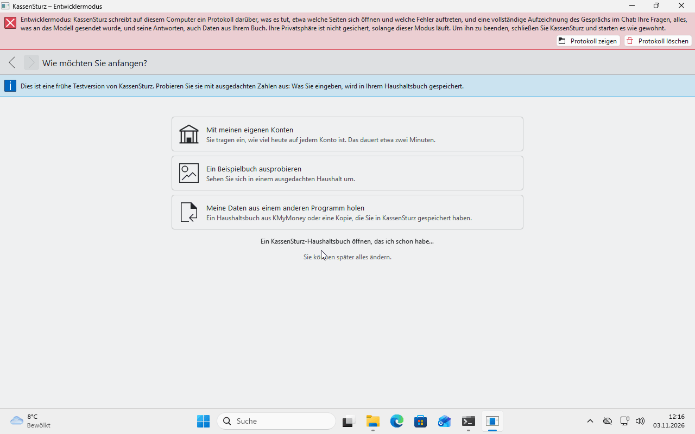
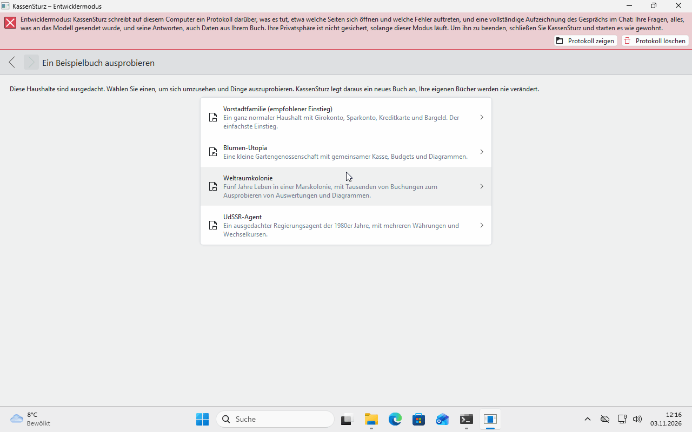

# 3. Der erste Start

*Diese Seite führt durch den Einrichtungsassistenten. Er fragt nur das Nötigste, und es wird erst etwas gespeichert, wenn Sie einen Schritt abschließen.*

Beim allerersten Start öffnet sich der Assistent. Sie können in jedem Schritt zurückgehen. Schließen Sie das Fenster mittendrin, beginnt der Assistent beim nächsten Mal von vorn; nichts ist dann angelegt.

## Schritt 1: Willkommen

Sie wählen Ihre **Sprache** (die Ihres Systems ist schon eingestellt) und die **Währung**, die Sie verwenden. Meist bestätigen Sie nur mit **Weiter**. Ändern Sie die Sprache, startet KassenSturz einmal neu in dieser Sprache; es geht nichts verloren.

## Schritt 2: Wie möchten Sie anfangen?

Drei Wege:

- **Mit meinen eigenen Konten:** etwa zwei Minuten.
- **Ein Beispielbuch ausprobieren:** ein ausgedachter Haushalt zum Umsehen.
- **Meine Daten aus einem anderen Programm holen:** ein KMyMoney-Buch oder eine zuvor mit KassenSturz gespeicherte Kopie.

Wer schon ein KassenSturz-Buch hat, nimmt den kleinen Link **Ein KassenSturz-Haushaltsbuch öffnen, das ich schon habe…**.

## Der Weg „Mit meinen eigenen Konten“

1. Legen Sie Ihre Konten an: die **Art** (Girokonto, Sparkonto, Bargeld, Kreditkarte), einen **Namen** und **wie viel heute darin ist**. Nehmen Sie den Betrag aus Ihrer Banking-App oder vom Kontoauszug, damit KassenSturz von dem ausgeht, was wirklich da ist. Leer gelassen heißt: nichts drin.
2. Mit **Haushaltsbuch anlegen** wird alles auf einmal gespeichert.
3. KassenSturz fragt, wie neue Buchungen hineinkommen: **Ich tippe sie selbst ein**, **Eine Datei von meiner Bank importieren** oder **Mit meiner Bank verbinden**. Das lässt sich später ändern.
4. Sie sehen die **Übersicht** mit einer kurzen Meldung, dass Ihr Haushaltsbuch bereit ist.

KassenSturz legt für Sie **Kategorien** an (Einnahmen wie Gehalt, Ausgaben wie Wohnen, Essen, Gesundheit). Sie gehören Ihnen: umbenennen, verschieben und ergänzen dürfen Sie alles (Seite 6).

## Der Weg „Ein Beispielbuch ausprobieren“

Zur Auswahl stehen:

- *Vorstadtfamilie*: ein ganz normaler Haushalt, der empfohlene Einstieg.
- *Blumen-Utopia*: eine kleine Gartengenossenschaft mit gemeinsamer Kasse, Budgets und Diagrammen.
- *Weltraumkolonie*: fünf Jahre in einer Marskolonie.
- *UdSSR-Agent*: ein ausgedachter Agent der 1980er Jahre mit mehreren Währungen.

Es entsteht eine **eigene Kopie**; das mitgelieferte Beispiel bleibt unverändert. Sie können darin nach Herzenslust ändern und löschen. Später öffnen Sie ein Beispielbuch erneut über **Einstellungen › Anderes Haushaltsbuch öffnen…**.

## Der Weg „Daten aus einem anderen Programm“

KassenSturz liest Bücher von **KMyMoney** (Dateien auf `.kmy` oder SQLite) und eine früher mit KassenSturz gespeicherte Kopie. Gespeicherte Berichte aus KMyMoney kommen als Ansichten in den Statistiken mit (Seite 16). Eine Datei wird nur gelesen, nie verändert.

## Wo liegt mein Haushaltsbuch?

KassenSturz legt es selbst in einem eigenen Ordner an und öffnet es bei jedem Start wieder; Sie müssen keine Datei auswählen. Unter **Einstellungen** öffnen Sie ein anderes Buch (**Anderes Haushaltsbuch öffnen…**) oder legen ein neues an (**Neues Haushaltsbuch anlegen…**), zum Beispiel zum Üben.

Ein Buch ist immer nur an **einem** Ort geöffnet. Liegt es auf einem Netzlaufwerk, warnt KassenSturz. Meldet es „Dieses Buch ist auf … geöffnet“, schließen Sie es dort und wählen **Erneut versuchen**.

**Wenn etwas anders aussieht:** Hat Ihre Version zusätzliche Schritte, lesen Sie die Frage auf dem Bildschirm; jeder Schritt sagt, was als Nächstes passiert.
