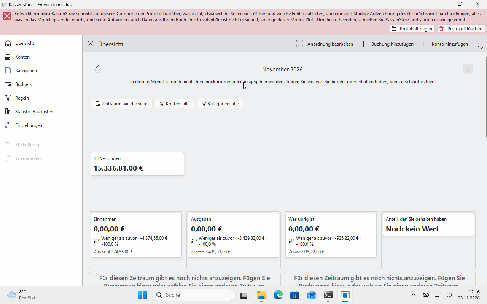

# 4. Die Übersicht und Ihre Dashboards

*Die Übersicht ist die Startseite von KassenSturz. Diese Seite erklärt, was sie zeigt, wie Sie in andere Monate blättern und wie Sie eigene Seiten mit Diagrammen und Zahlen anlegen.*

## Was die Übersicht zeigt

- Was alle Ihre Konten **zusammen** heute enthalten.
- Für einen Monat: **Geld rein**, **Geld raus** und was **übrig** bleibt. Ist mehr hinausgegangen als hereingekommen, steht dort „Mehr ausgegeben als hereingekommen“.
- **Wohin Ihr Geld ging** und **woher es kam**, nach Kategorien, die größten zuerst. Was Sie noch keiner Kategorie zugeordnet haben, steht unter **Noch nicht zugeordnet**.
- Haben Sie Budgets festgelegt, erscheinen auch ihre Balken (Seite 13). Ohne Budget nehmen sie keinen Platz weg.
- Ist ein mit der Bank verbundenes Konto lange nicht abgerufen worden, warnt die Übersicht mit dem Namen des Kontos und dem Tag (Seite 11).

## Andere Monate ansehen

Mit den **Pfeilen neben dem Monatsnamen** blättern Sie zurück, so weit Ihr Buch Buchungen hat, und vorwärts bis zum jetzigen Monat oder weiter, wenn Sie etwas für einen späteren Monat eingetragen haben. **Zurück zu diesem Monat** bringt Sie in den jetzigen.

## Was nicht mitzählt

- **Geld, das Sie zwischen eigenen Konten umbuchen**, ist weder Geld rein noch Geld raus (Seite 8). Eine Gebühr dafür zählt als Geld raus.
- **Anfangsbestände** zählen ebenfalls nicht.
- **Mehrere Währungen:** Jede Währung hat ihre eigenen Konten, Summen und Kategorien. KassenSturz zählt Euro und Dollar nie zusammen.

## Eigene Dashboards

Ein **Dashboard** ist eine Seite, die Sie selbst zusammenstellen: Diagramme, Tabellen, Zahlenkarten und Budgetbalken. Die Übersicht ist das erste Dashboard.

- **Neues Dashboard …** im Menü der Übersicht legt eine zweite Seite an. Sie beginnt leer, das Menü zum Hinzufügen ist schon offen. Mit **Fertig** behalten Sie die Seite.
- **Reiter:** Sobald Sie zwei Dashboards haben, erscheinen oben Reiter. Mit **Strg+Bild ab** und **Strg+Bild auf** springen Sie zum nächsten und zum vorigen.
- **Das Dashboard-Menü** (ab zwei Dashboards) benennt um, kopiert, verschiebt und löscht das Dashboard, das Sie gerade sehen. **Als Standard festlegen** bestimmt, mit welchem Ihr Buch öffnet; sein Reiter zeigt ein kleines Haus. Solange Sie nichts festlegen, öffnet das Buch mit der Übersicht.
- **Anordnung bearbeiten** erlaubt, Elemente hinzuzufügen, zu verschieben und zu entfernen. **Zur Seite hinzufügen** legt ein Element auf die Seite; **Eigenschaften** öffnet die Einstellungen eines Elements (Zeitraum, Konten, Kategorien, Farben). **Fertig** speichert das Layout.
- **Als neues Dashboard speichern …** behält die Seite, die Sie gerade anordnen, als zusätzliches Dashboard.
- **Dieses Dashboard in einer Datei speichern** und **Dashboard aus einer Datei hinzufügen** geben ein Dashboard an ein anderes Buch weiter. Die Datei enthält **keine Beträge, Buchungen oder Kontonummern**, nur die Namen der Konten und Kategorien.
- Jeder dieser Schritte ist eine Änderung, die **Rückgängig** zurücknimmt.

## Der Filter einer Seite

Über den Elementen sitzt die **Filterleiste**: Zeitraum, Konten und Kategorien gelten für alle Elemente, die der Seite folgen. Mit **Filter zurücksetzen** zählt wieder alles. Ein Element kann in seinen **Eigenschaften** auch einen eigenen Filter haben; ein grauer Filterhinweis sagt dann, was es zählt. Unter **Einstellungen** blenden Sie die grauen Hinweise aus (**Graue Filterhinweise ausblenden**).

Ein Zeitraum kann auch mit dem heutigen Tag wandern, etwa **Die letzten Monate …** oder **Ein Gehaltsmonat …** (Seite 14), damit ein Diagramm nie veraltet.

**Wenn etwas anders aussieht:** Die Elemente, die Sie auf Ihrer Übersicht sehen, hängen von Ihrem Buch ab. Ein Beispielbuch wie *Blumen-Utopia* zeigt mehr davon als ein neues Buch.
