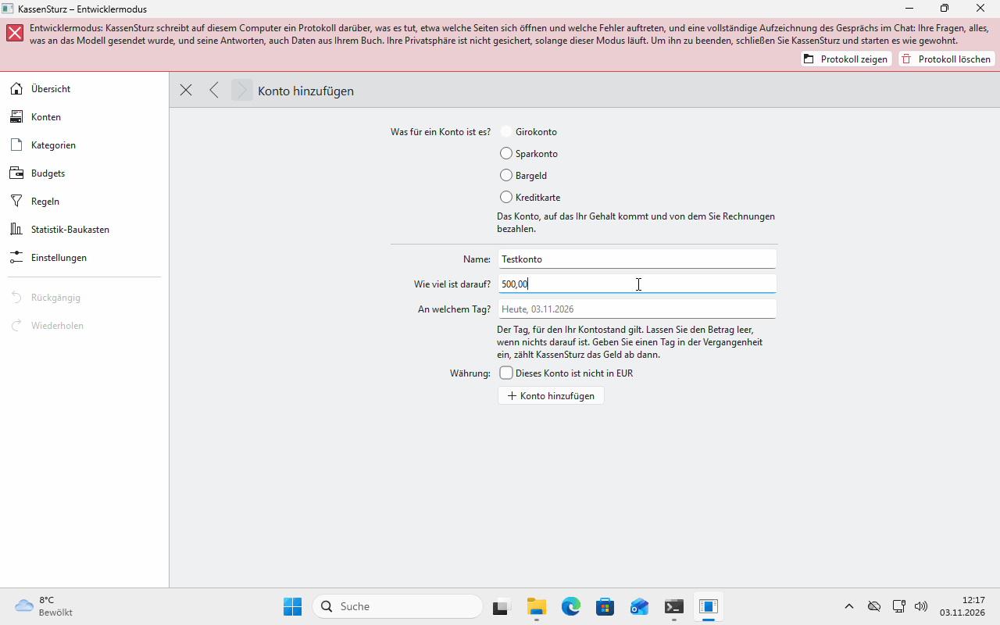

# 5. Konten

*Ein Konto ist ein Ort, an dem Ihr Geld liegt. Diese Seite zeigt, wie Sie Konten anlegen, ansehen, mit der Bank abgleichen und schließen.*

## Die Kontenseite

**Konten** im Menü links zeigt Ihre Konten nebeneinander mit dem, was darin ist. Bei einer Kreditkarte steht „Sie schulden …“. Ab zwei Konten zeigt **Alles zusammen**, was Sie haben minus das, was Sie schulden.

## Arten von Konten

Girokonto, Sparkonto, Bargeld und Kreditkarte. Jedes Konto hat eine Währung. Ein Konto in einer anderen Währung legen Sie bei Bedarf später an (Seite 7).

## Ein Konto hinzufügen

1. Wählen Sie auf der Kontenseite **Konto hinzufügen**.
2. Wählen Sie die **Art**, geben Sie einen **Namen** an, den **Betrag**, der heute darin ist, und den Tag. Den Betrag nehmen Sie aus Ihrer Banking-App oder vom Kontoauszug, damit KassenSturz von dem ausgeht, was wirklich da ist. Zum Üben dürfen Sie sich einen ausdenken.

## Ein Konto öffnen

Klicken Sie die Karte des Kontos an. Sie sehen alle Buchungen, die neueste zuerst, und daneben, was nach jeder Buchung im Konto war („Dann: 946,80 €“). Wie Sie sie eintragen, steht auf Seite 7.

Rechts oben, unter **Über dieses Konto**, können Sie das Konto:

- **umbenennen**,
- **mit der Bank abgleichen**,
- **schließen**.

## Mit der Bank abgleichen

Tippen Sie ein, was Ihre Bank an einem Tag als Kontostand nennt. KassenSturz sagt, ob es stimmt. Wenn nicht, zeigt es den Unterschied auf den Cent genau und nennt mögliche Gründe: eine doppelte oder eine fehlende Buchung, einen falschen Anfangsstand. **Es ändert nichts von allein.** Stimmt Ihr Anfangsstand nicht, bietet es an, ihn zu berichtigen; das tun nur Sie.

## Ein Konto schließen

Ein Konto lässt sich schließen, wenn nichts mehr darauf ist, zum Beispiel eine Karte, die die Bank ersetzt hat. Seine Geschichte bleibt erhalten; es nimmt nur keine neuen Buchungen mehr an und verschwindet aus den Listen. Sie können es wieder öffnen.

## Konten und Bank

Ist ein Konto mit einem Bankkonto verknüpft, steht das auf der Kontenseite mit dem Tag der letzten Abfrage (Seite 11).

**Wenn etwas anders aussieht:** Der Stand eines Kontos ist immer die Summe seiner Buchungen. Stimmt er nicht mit der Bank überein, hilft der Abgleich weiter.
