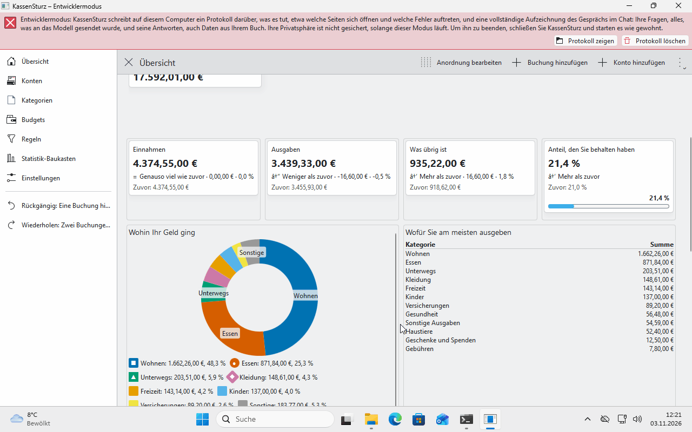

# 6. Kategorien und Kategoriegruppen

*Kategorien sagen, wofür Sie Geld ausgegeben haben und woher es kam. Diese Seite zeigt, wie Sie sie ansehen, ändern und zusammenfassen.*

## Der Baum

**Kategorien** im Menü links zeigt, woher Geld kommt und wofür es ausgegeben wird, als Baum. Eine Kategorie kann in einer anderen liegen, zum Beispiel *Lebensmittel* in *Essen*, beliebig tief.

KassenSturz legt beim Start Kategorien für Sie an (Einnahmen wie Gehalt, Ausgaben wie Wohnen, Essen, Gesundheit). Sie gehören Ihnen; Sie dürfen alles umbenennen, verschieben und ergänzen.

## Kategorie hinzufügen, ändern, verschieben

- **Kategorie hinzufügen** legt eine neue an. Sie ist entweder für Geld, das Sie erhalten, oder für Geld, das Sie ausgeben.
- Klicken Sie eine Kategorie an, um sie **umzubenennen** oder **zu verschieben**.
- Ändern Sie den Namen, ändert sich die Kategorie in allen Buchungen mit; die Buchungen selbst bleiben.
- Löschen geht nur, wenn die Kategorie keine Buchungen mehr hat; KassenSturz sagt Ihnen, dass Sie diese zuerst einer anderen Kategorie zuordnen müssen. Eine Kategorie für Einnahmen gehört nur in eine für Einnahmen, eine für Ausgaben nur in eine für Ausgaben.

## „Noch nicht zugeordnet“

Eine Buchung ohne Kategorie steht als **Noch nicht zugeordnet**. Das ist erlaubt und wird auf der Übersicht ausgewiesen. Regeln (Seite 12) sortieren neue Buchungen von selbst; den Rest ordnen Sie auf der Buchungsseite zu.

## Kategoriegruppen

Eine **Kategoriegruppe** fasst Kategorien zusammen, die nicht im selben Ast liegen, zum Beispiel „Fixkosten“ aus Miete, Strom und Versicherung. Gruppen verändern keine Buchung; sie sind eine Auswahl, die Sie in Diagrammen, Filtern und Budgets verwenden können (Seiten 13 und 14).

## Mehrere Währungen

In jeder Währung gibt es eigene Kategorien-Summen. Eine Kategorie, die in einer anderen Währung zählt, etwa *Reisen* in Dollar, wird mit dem aufgeführt, was Sie von Ihrem Konto bezahlt haben.

**Wenn etwas anders aussieht:** Die Namen im Baum sind Vorschläge. Passen sie nicht zu Ihnen, ändern Sie sie; nichts davon ist festgelegt.
