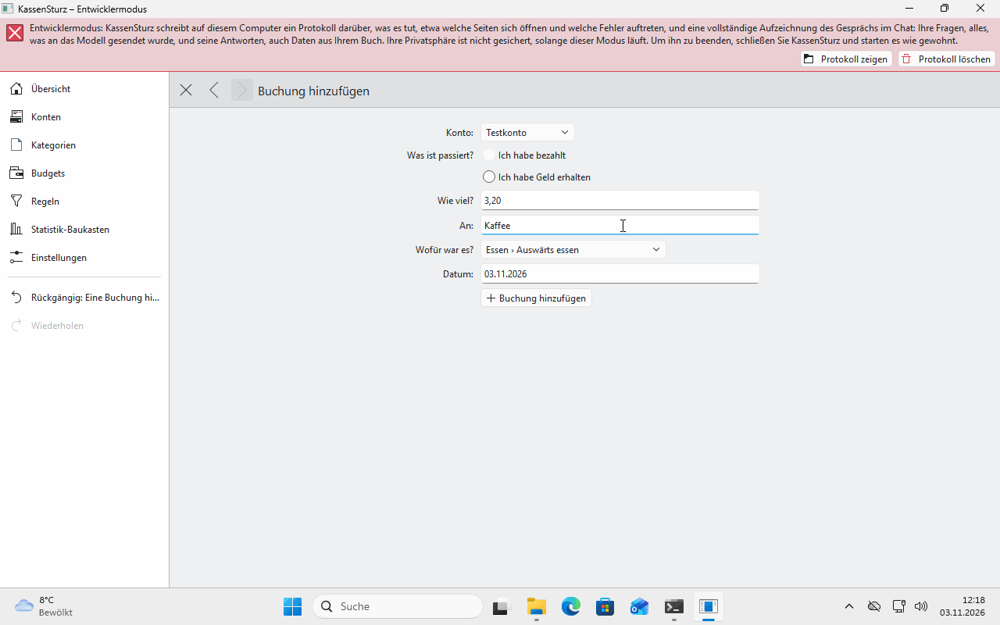
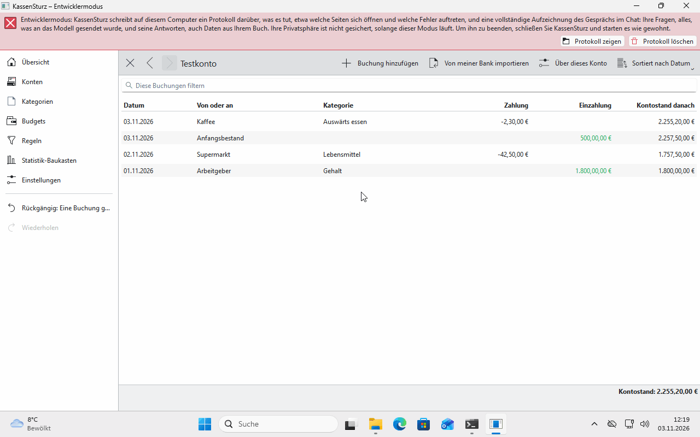

# 7. Buchungen eintragen, ändern, aufteilen

*Eine Buchung ist eine Zahlung oder Gutschrift. Diese Seite zeigt, wie Sie eine eintragen, wiederfinden, ändern, aufteilen und in einer anderen Währung buchen.*

## Eine Buchung eintragen

1. Öffnen Sie das Konto und wählen Sie **Buchung hinzufügen**.
2. Sagen Sie, was passiert ist: **Ich habe bezahlt** oder **Ich habe Geld erhalten**. Dann: **wie viel**, **von wem oder an wen**, **wofür** und **wann**.
3. Beträge tippen Sie so, wie Ihre Einstellungen sie zeigen, in Deutschland zum Beispiel `53,20`.
4. **Noch nicht zugeordnet** lässt die Kategorie offen; Sie können sie später zuordnen.
5. Speichern. Eine Meldung sagt, was getan wurde, mit einem Knopf **Rückgängig**.

## Die Liste eines Kontos

- **Sortiert nach** ordnet nach Datum, Betrag, Name oder Kategorie.
- **Diese Buchungen filtern** zeigt nur Buchungen, die **alle** Ihre Suchwörter enthalten. „Versuchen Sie andere Wörter“ erscheint, wenn nichts passt; leeren Sie das Feld, sehen Sie wieder alle.
- Bei Buchungen von der Bank sehen Sie in den Einzelheiten, was die Bank geliefert hat (**Wie geliefert**), zum Beispiel Verwendungszweck und Wertstellung. Ihre Änderungen, etwa ein klarerer Name oder die Kategorie, liegen darüber.

## Ändern und löschen

Klicken Sie eine Buchung an, um sie zu ändern. **Löschen** nimmt sie aus der Liste und aus dem Kontostand. **Rückgängig** bringt sie zurück (Seite 9).

## Eine Buchung aufteilen

Eine Rechnung im Supermarkt kann aus Lebensmitteln und Haushaltswaren bestehen.

1. Öffnen Sie die Buchung und wählen Sie **Diese Buchung aufteilen**.
2. Fügen Sie **Teile** hinzu und sagen Sie bei jedem, wofür er war.
3. Ein Teil darf ohne Betrag bleiben; KassenSturz rechnet den Rest aus.
4. Die Teile müssen zusammen die ganze Buchung ergeben. Sonst sagt die Seite, um wie viel es abweicht.

Das geht jederzeit, nicht nur beim Einlesen.

## In einer anderen Währung

Ein Teil in einer anderen Währung behält seinen **Originalbetrag**. Dazu merkt sich KassenSturz den **Wechselkurs**, den Tag und die Quelle, mit der der Betrag in die Währung der Buchung umgerechnet wurde. Hat Ihr Buch für den Tag noch keinen Wechselkurs, tippen Sie ein, was der Teil in dieser Währung war, zum Beispiel von der Quittung. Wechselkurse tragen Sie von Hand ein; KassenSturz holt keine aus dem Internet.

Eine Buchung geht immer **in einer Währung** auf. Rundet KassenSturz einmal, etwa bei einer Umrechnung, steht die Regel dafür in den Einstellungen und gilt nur für künftige Rechnungen.

**Wenn etwas anders aussieht:** Wird ein Betrag nicht angenommen („Das ist kein Betrag“), tippen Sie ihn so, wie die Meldung ihn zeigt, in Deutschland also `1.234,56`.
