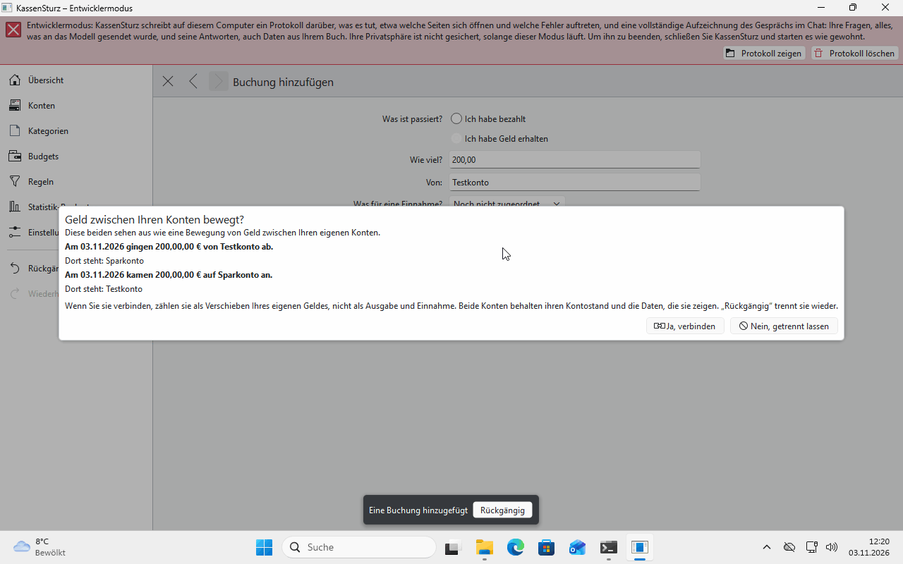
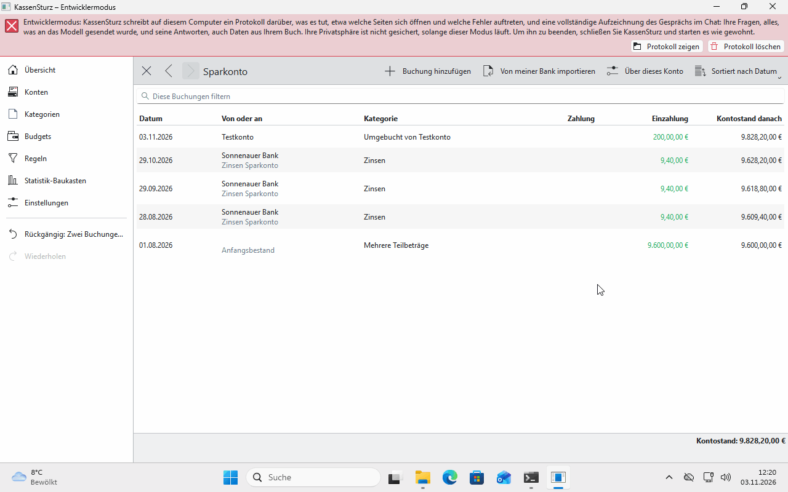

# 8. Geld zwischen eigenen Konten umbuchen

*Legen Sie Geld von einem Ihrer Konten auf ein anderes, ist das weder Ausgabe noch Einnahme. Diese Seite zeigt, wie KassenSturz das erkennt und wie Sie es selbst verbinden.*

## Das Beispiel

Sie legen 200 € vom Girokonto aufs Sparkonto.

1. Tragen Sie im Girokonto **Ich habe bezahlt** 200 € ein und im Sparkonto **Ich habe Geld erhalten** 200 €, beide mit **Noch nicht zugeordnet**.
2. Nach der zweiten Buchung fragt KassenSturz: **Geld zwischen Ihren Konten bewegt?** Antworten Sie **Ja, verbinden**.

Die beiden Buchungen sind nun eine **Umbuchung**. Sie zählt auf der Übersicht weder als Geld rein noch als Geld raus.

## Wann fragt KassenSturz?

Die beiden Seiten müssen:

- **gleich hoch** sein,
- in **derselben Währung** liegen,
- **höchstens drei Werktage** auseinanderliegen,
- in **verschiedenen Konten** stehen.

Bei **Nein** bleiben die Buchungen getrennt. Das gilt auch beim Einlesen von Bankdaten: KassenSturz schlägt dort passende Paare vor.

## Wieder trennen

**Rückgängig** trennt eine Verbindung wieder; die beiden Buchungen bleiben als einzelne Zahlungen stehen.

## Gebühren

Eine Gebühr, die bei einer Umbuchung anfällt, ist eine Ausgabe wie jede andere und zählt als Geld raus.

**Wenn etwas anders aussieht:** Fragt KassenSturz nicht, passt eine der vier Bedingungen nicht, meist der Betrag oder der Abstand der Tage.
