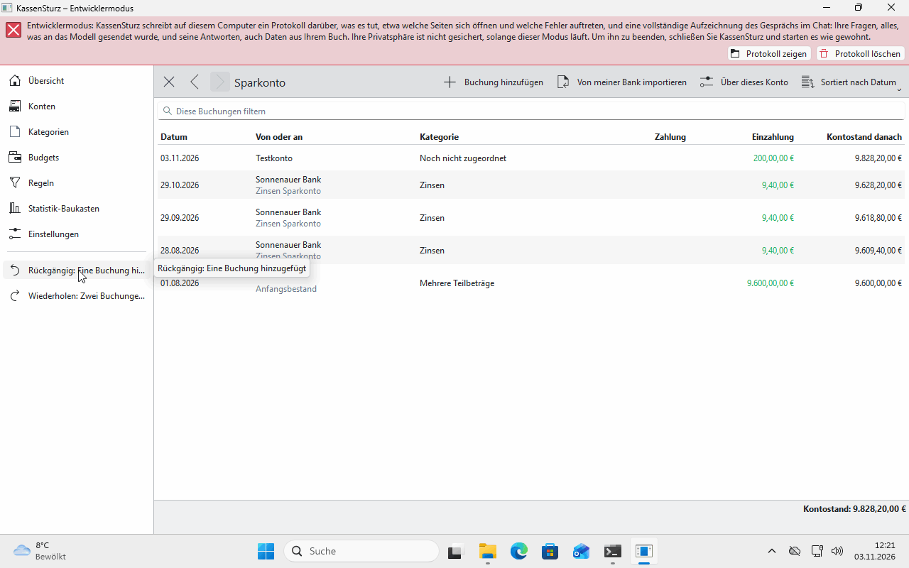

# 9. Rückgängig, Wiederholen und der Verlauf

*Sie können nichts so ändern, dass es nicht mehr zurückgeht. Diese Seite erklärt, wie.*

## Rückgängig und Wiederholen

- **Rückgängig** und **Wiederholen** stehen im Menü und auf **Strg+Z** und **Strg+Umschalt+Z**.
- Sie sagen, was sie tun, zum Beispiel „Rückgängig: Eine Buchung entfernt“.
- Rückgängig nimmt **immer die neueste Änderung** zurück, auch nachdem Sie das Buch geschlossen und wieder geöffnet haben.

## Der Verlauf

Unter **Einstellungen** zeigt **Verlauf anzeigen** die letzten 100 Änderungen mit Tag und Uhrzeit. KassenSturz hebt den Verlauf 30 Tage auf, wenn Sie nichts anderes wählen. Wie lange, stellen Sie in den Einstellungen ein.

## Verlauf bereinigen

**Verlauf bereinigen** löscht die ganze Geschichte endgültig, auch aus der Datei. **Danach lässt sich nichts, was bisher getan wurde, mehr rückgängig machen.** KassenSturz sagt das vorher und fragt nach.

## Sicherungen

Vor dem Anpassen eines Buches an eine neue Version legt KassenSturz selbst eine **Sicherung** des ganzen Buches an (**Einstellungen › Sicherungen**) und behält die letzten zehn.

**Wenn etwas anders aussieht:** Nach einer Meldung wie „Rückgängig kann die Buchung nur zurückbringen, bis Sie dieses Buch schließen“ ist in Ihren Einstellungen kein Verlauf vorgesehen. Dort stellen Sie ihn ein.
