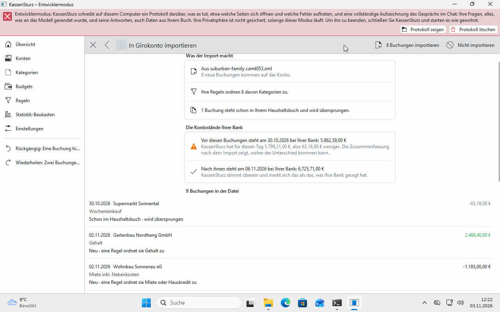
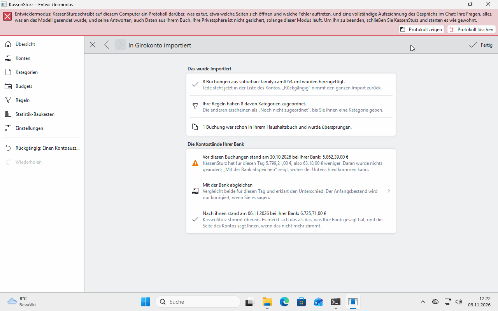

# 10. Einen Kontoauszug einlesen

*Statt jede Buchung zu tippen, lesen Sie eine Datei Ihrer Bank ein. Diese Seite zeigt den Weg und was die Vorschau sagt, bevor irgendetwas passiert.*

## Welche Dateien gehen

Laden Sie in Ihrem Online-Banking einen Kontoauszug herunter, als:

- **CAMT.053** (`.xml`),
- **MT940** (`.sta`),
- **OFX** (`.ofx`) oder
- **CSV** (`.csv`, `.txt`).

## Der Weg

1. Öffnen Sie in KassenSturz das passende Konto.
2. Wählen Sie **Von meiner Bank importieren** und die Datei.
3. Bei einer **CSV-Datei** fragt KassenSturz, wie sie zu lesen ist: Trennzeichen, Spalten, Datumsform und Ähnliches. Die Vorschau zeigt sofort, ob Ihre Wahl stimmt. Sie wird für die nächste Datei derselben Bank gemerkt.
4. Lesen Sie die **Vorschau** (unten).
5. **Importieren**, oder **Nicht importieren**.

## Die Vorschau

Sie sagt, **bevor etwas passiert**:

- wie viele Buchungen **neu** sind,
- wie viele **Schon im Haushaltsbuch** stehen; die werden nicht doppelt übernommen,
- wie viele **Vielleicht schon im Haushaltsbuch** stehen, weil sie einer vorhandenen Buchung ähneln (gleicher Betrag, wenige Tage Abstand). Sie werden nur übernommen, wenn Sie es sagen; darunter sehen Sie, was sie unterscheidet,
- wie viele **Zweimal in der Datei** stehen und nur einmal zählen,
- wie viele **Von der Bank noch nicht gebucht** sind; die lässt der Import aus, sie kommen mit einem späteren Auszug,
- wie viele Ihre **Regeln** gleich sortieren,
- bei Umbuchungen: welche Paare KassenSturz erkannt hat (Seite 8).

Schließen Sie die Vorschau, ändert sich nichts.

## Danach

KassenSturz vergleicht den Kontostand mit dem der Datei und sagt, ob er übereinstimmt. **Rückgängig** nimmt den ganzen Import als einen Schritt zurück.

KassenSturz rundet oder rät dabei nie: Ein Betrag, den es nicht genau lesen kann, stoppt den Import, und es wird nichts übernommen.

**Wenn etwas anders aussieht:** Hat die Datei sehr viele Einträge, bittet KassenSturz Sie, einen kürzeren Zeitraum zu laden und die Teile nacheinander einzulesen.
