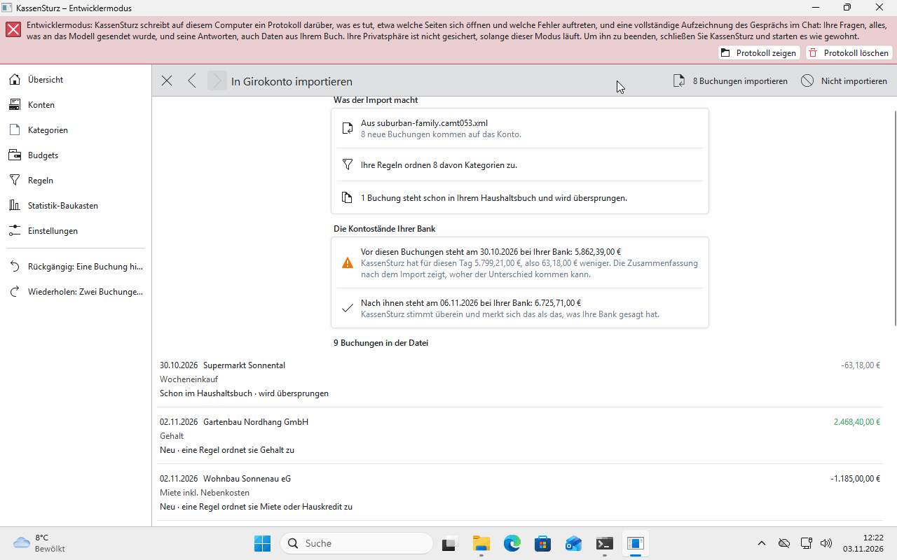
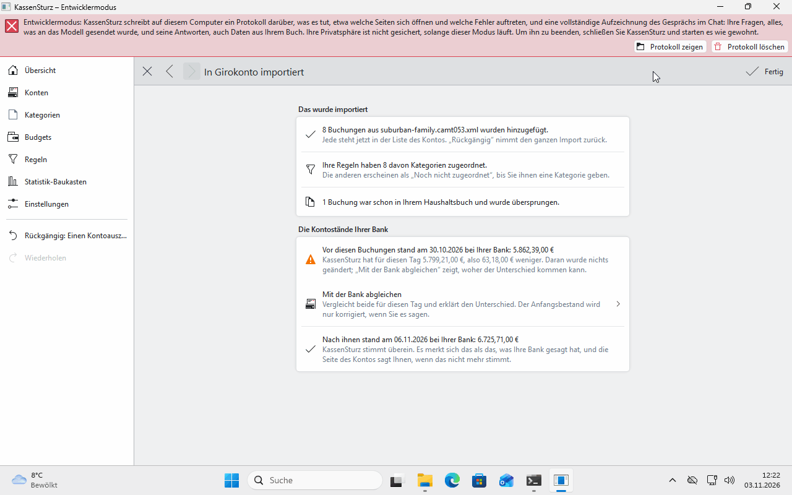

# 10. Einen Kontoauszug einlesen

*Statt jede Buchung zu tippen, lesen Sie eine Datei Ihrer Bank ein. Diese Seite zeigt den Weg und was die Vorschau sagt, bevor irgendetwas passiert.*

## Welche Dateien gehen

Laden Sie in Ihrem Online-Banking einen Kontoauszug herunter, als:

- **CAMT.053** (`.xml`),
- **MT940** (`.sta`),
- **OFX** (`.ofx`) oder
- **CSV** (`.csv`, `.txt`).

Das sind vier Arten, wie eine Bank einen Kontoauszug in eine Datei schreibt; die Buchstaben in Klammern sind die Dateiendung. Bietet Ihre Bank mehrere an, nehmen Sie die erste aus dieser Liste, die sie hat: Die ersten drei werden ohne weitere Fragen gelesen, und CSV ist für Banken da, die nichts anderes anbieten. Ein Kontoauszug als PDF, also der zum Ausdrucken, lässt sich nicht einlesen.

**Wo Sie die Datei finden:** Melden Sie sich auf der Webseite Ihrer Bank an und öffnen Sie das Konto. Suchen Sie einen Knopf, der etwa **Export**, **Herunterladen** oder **Umsätze speichern** heißt, wählen Sie den Zeitraum und eine der Arten oben. Ihr Browser legt die Datei in Ihren Ordner **Downloads**, wenn Sie keinen anderen Ort wählen. Jede Bank nennt das etwas anders; finden Sie es nicht, kennen die Hilfeseiten oder die Hotline der Bank es als „Umsätze exportieren“.

## Der Weg

1. Öffnen Sie in KassenSturz das passende Konto.
2. Wählen Sie **Von meiner Bank importieren** und die Datei.
3. Bei einer **CSV-Datei** fragt KassenSturz, wie sie zu lesen ist: Trennzeichen, Spalten, Datumsform und Ähnliches. Die Vorschau zeigt sofort, ob Ihre Wahl stimmt. Sie wird für die nächste Datei derselben Bank gemerkt.
4. Lesen Sie die **Vorschau** (unten).
5. **Importieren**, oder **Nicht importieren**.

## Die Vorschau

Sie sagt, **bevor etwas passiert**:

- wie viele Buchungen **neu** sind,
- wie viele **Schon im Haushaltsbuch** stehen; die werden nicht doppelt übernommen,
- wie viele **Vielleicht schon im Haushaltsbuch** stehen, weil sie einer vorhandenen Buchung ähneln (gleicher Betrag, wenige Tage Abstand). Sie werden nur übernommen, wenn Sie es sagen; darunter sehen Sie, was sie unterscheidet,
- wie viele **Zweimal in der Datei** stehen und nur einmal zählen,
- wie viele **Von der Bank noch nicht gebucht** sind; die lässt der Import aus, sie kommen mit einem späteren Auszug,
- wie viele Ihre **Regeln** gleich sortieren,
- bei Umbuchungen: welche Paare KassenSturz erkannt hat (Seite 8).

Schließen Sie die Vorschau, ändert sich nichts.

### Der erste Import in ein Konto

Sie haben den Kontostand für einen Tag angegeben, meist für heute. Die erste Datei oder der erste Abruf von der Bank bringt meist die Buchungen aus der Zeit *davor*. Damit sie Ihren Kontostand nicht ein zweites Mal verändern, berechnet KassenSturz, was vor der ersten dieser Buchungen auf dem Konto war: aus dem Kontostand, den Ihre Bank nennt (oder, wenn die Datei keinen enthält, aus dem, den Sie angegeben haben). Die Vorschau sagt das unter **Anfangsbestand**, mit Betrag und Tag vorher und nachher. Ihr Kontostand bleibt, was Ihre Bank sagt, und **Rückgängig** nimmt das zusammen mit dem Import zurück.

Das geschieht nur beim ersten Import in ein Konto. Später ändert KassenSturz den Anfangsbestand nie von allein; weichen die Zahlen ab, zeigt **Mit der Bank abgleichen**, warum (Seite 5).

## Danach

KassenSturz vergleicht den Kontostand mit dem der Datei und sagt, ob er übereinstimmt. **Rückgängig** nimmt den ganzen Import als einen Schritt zurück.

KassenSturz rundet oder rät dabei nie: Ein Betrag, den es nicht genau lesen kann, stoppt den Import, und es wird nichts übernommen.

**Wenn etwas anders aussieht:** Hat die Datei sehr viele Einträge, bittet KassenSturz Sie, einen kürzeren Zeitraum zu laden und die Teile nacheinander einzulesen.
