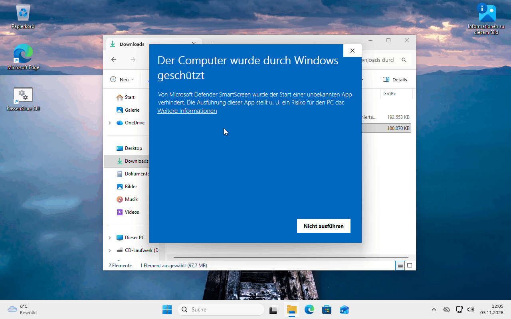

# 2. Install and update

*This page says where to get KassenSturz for your system and how to update it. Your household books are kept with every new version.*

## Windows: from the Microsoft Store (recommended)

Open **https://apps.microsoft.com/detail/9NM5V48PPRLQ** and click **Get** (or **Install**). The Store installs KassenSturz and later updates it by itself. Windows shows no warning, because the Store checks and signs the program.

## Linux: from the Snap Store (recommended)

Open a terminal, a window in which you type commands (on Ubuntu and Kubuntu: press Ctrl+Alt+T). Type this line and press Enter; it asks for your password once, and nothing shows while you type it:

```sh
sudo snap install kassensturz
```

Then start **KassenSturz** from the app menu. The store installs the stable release and later updates it by itself. A few things are switched off in the snap until you allow them, for example saving your banking PIN in the keychain; [the project's install page](../../INSTALL.md) lists them with the command for each.

## Stable and beta

- The **stable** release is the one for everyday use, with your own household book. A copy of your own from time to time is still wise (page 17).
- A **beta** build is newer and may have more bugs. It is for trying things out; use an example book or a copy of your book there. From the Snap Store you get it with `sudo snap install kassensturz --beta`.

KassenSturz as a whole is still in its Beta stage: every version number starts with `0.` until version 1.0.

## Other ways: the releases page

In your browser, open **https://github.com/Vondor/KassenSturz/releases**. You don't need a GitHub account. Take the release marked **Latest**: that is the stable one. Releases marked **Pre-release** are beta builds.

Under **Assets**, download exactly one file:

| Your system | The file | More help |
|---|---|---|
| **Windows** (installer, if you don't use the Store) | ends in `-windows-x64-setup.exe` | [Windows install sheet](../../testing/INSTALL_WINDOWS.en.md), written for test sessions, with every click |
| **Windows** (without installing) | ends in `-windows-x64.zip`; you unpack it and start the program from there | the same sheet |
| **Linux** (if you don't use the Snap Store) | ends in `.flatpak` | [the project's install page](../../INSTALL.md) has the three commands |
| **Mac** with an Apple chip (experimental, nobody has tested it on a real Mac) | ends in `-macos-arm64-experimental.dmg` | [KassenSturz on macOS](../../MACOS.md) |

You don't need *Source code (zip)* or *Source code (tar.gz)*; those are for developers.

## Windows shows a warning. What now?

This only happens with the files from the releases page, not with the Store. The installer and the zip are not signed, so Windows says once that it "protected your PC". The sheet shows step by step how to confirm the message. The installer sets KassenSturz up for your user account only; you normally don't need administrator rights.



## Updating

- From the Microsoft Store or the Snap Store: nothing to do, the store updates KassenSturz by itself.
- With the Windows installer: run the newer installer; it replaces the program. If KassenSturz is still running, it asks you to close it.
- With the Flatpak file: install the newer file the same way as the first one.

**Your household books are not touched.** Before KassenSturz adapts a book to a new version, it makes a backup by itself (**Settings › Backups and undo**) and keeps the last ten.

> **Books from old test versions:** a book made by a test version from before the Beta (before 17 Nov 2026) doesn't open in today's versions. KassenSturz says so and how to carry the book over (page 19).

## Removing

- Windows: like any program, under **Settings › Apps** in Windows.
- Snap Store: `sudo snap remove kassensturz`.
- Flatpak: `flatpak uninstall --user io.github.vondor.KassenSturz`.

The Store version and the snap keep your household books and their backups in the folder `KassenSturz` in your Documents folder, and the Flatpak keeps them in its own folder; removing the program leaves them there until you delete them yourself. One exception: a book that an earlier snap made may still lie in the snap's own folder, which is deleted with the snap. KassenSturz offers to move such a book to your Documents folder when it starts; accept that before you remove the snap.

**If something looks different:** if you get stuck somewhere, [the project's install page](../../INSTALL.md) has more detail for each system.
