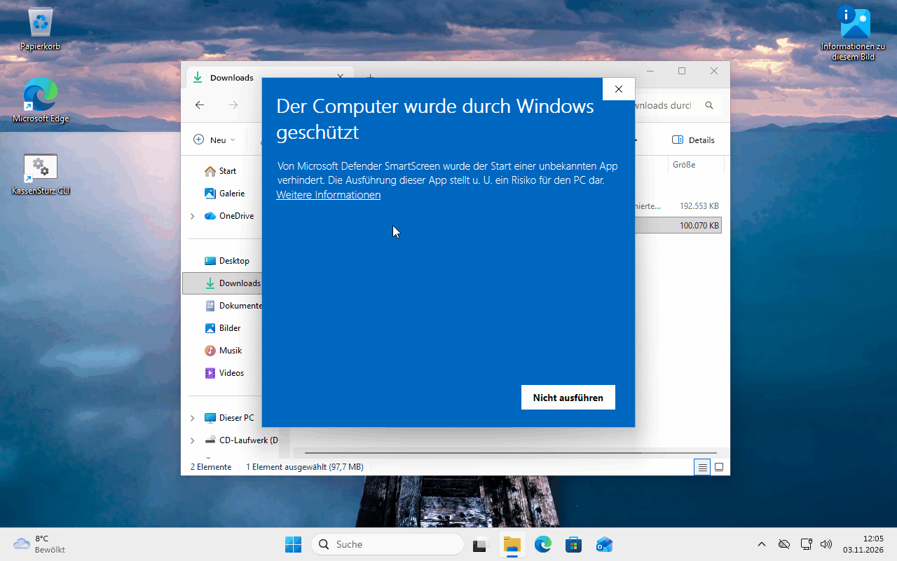

# 2. Install and update

*This page says which file to download and points to the sheets with every click. Your household books are kept with every new version.*

## Where to get KassenSturz

In your browser, open **https://github.com/Vondor/KassenSturz/releases**. You don't need a GitHub account. The version at the top is the newest. While KassenSturz is being tested, its card says **Pre-release** (a test version); that is as it should be.

Under **Assets**, download exactly one file:

| Your system | The file | The sheet with every click |
|---|---|---|
| **Windows** (installer, recommended) | ends in `-windows-x64-setup.exe` | [Windows install sheet](../../testing/INSTALL_WINDOWS.en.md) |
| **Windows** (without installing) | ends in `-windows-x64.zip`; you unpack it and start the program from there | the same sheet |
| **Ubuntu** and other Linux systems | ends in `.flatpak` | [Ubuntu install sheet](../../testing/INSTALL_UBUNTU.en.md) |

You don't need *Source code (zip)* or *Source code (tar.gz)*; those are for developers.

## Windows shows a warning. What now?

For a test version, Windows says once that it "protected your PC". The sheet shows step by step how to confirm the message. The installer sets KassenSturz up for your user account only; you normally don't need administrator rights.

## Updating

You simply install a newer version **over the old one**, the same way as the first time:

- On Windows, the installer starts and replaces the program. If KassenSturz is still running, it asks you to close it.
- On Ubuntu: `flatpak install --user --reinstall` with the new file (the command is in the sheet).

**Your household books are not touched.** Before KassenSturz adapts a book to a new version, it makes a backup by itself (**Settings › Backups**) and keeps the last ten.

> **Note for the test period:** books from older development versions may not open in newer ones. Before an update, save the whole book (page 17).

## Removing

Windows: like any program, under **Settings › Apps** in Windows. Ubuntu: `flatpak uninstall --user io.github.vondor.KassenSturz`. Your household books stay where they are until you delete them yourself.

**If something looks different:** if you get stuck somewhere, the install sheet for your system goes step by step; it also says how to make a log to pass on.
