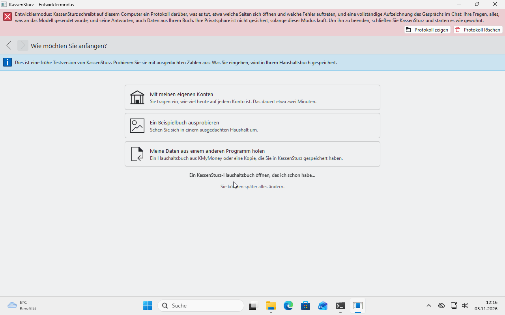
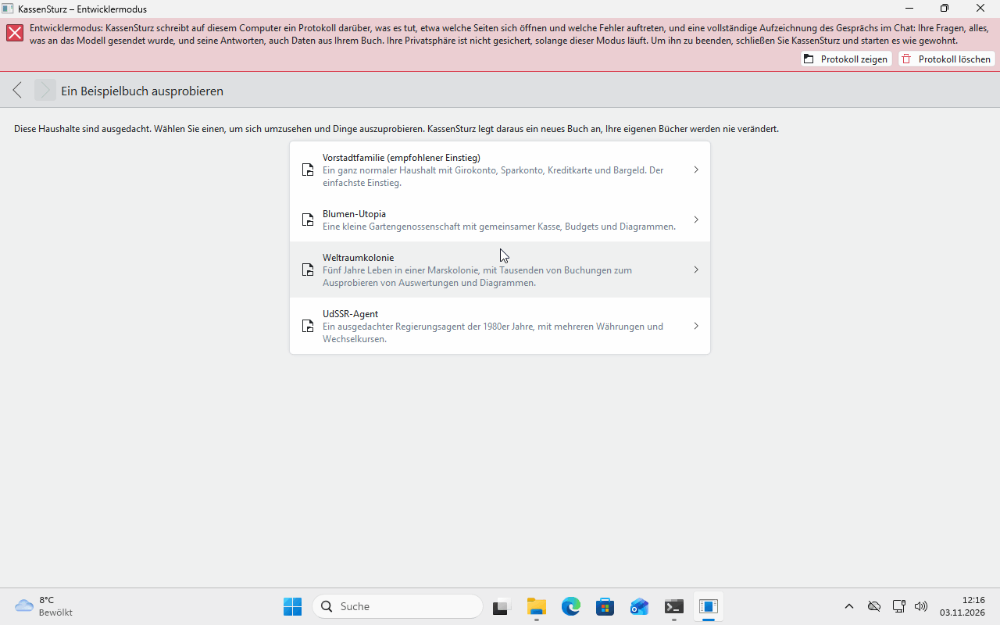

# 3. The first start

*This page takes you through the setup assistant. It asks only what is needed, and nothing is saved until you finish a step.*

At the very first start, the assistant opens. You can go back at every step. If you close the window halfway, the assistant starts from the beginning next time; nothing has been made then.

## Step 1: Welcome

You choose your **Language** (your system's is already set) and the **Currency** you use. Usually you only confirm with **Next**. If you change the language, KassenSturz restarts once in that language; nothing is lost.

## Step 2: How would you like to start?

Three ways:

- **My own accounts:** about two minutes.
- **Try an example book:** a made-up household to look around in.
- **Bring my data from another program:** a KMyMoney book or a copy saved earlier with KassenSturz.

If you already have a KassenSturz book, use the small link **Open a KassenSturz book I already have…**.

## The "My own accounts" way

1. Add your accounts: the **kind** (checking account, savings account, cash, credit card), a **name** and **how much is in it today**. Take the amount from your banking app or your bank statement, so KassenSturz starts from what is really there. Left empty means: nothing in it.
2. **Make the book** saves everything at once.
3. KassenSturz asks how new transactions come in: **I'll type them myself**, **Import a file from my bank** or **Connect to my bank**. You can change this later.
4. You see the **Overview** with a short message that your household book is ready.

KassenSturz makes **Categories** for you (money in, such as Salary; money out, such as Home, Food, Health). They are yours: you may rename, move and add to all of them (page 6).

## The "Try an example book" way

You can choose:

- *Suburban Family*: an ordinary household, the recommended start.
- *Flower Utopia*: a small garden co-operative with a shared cash box, budgets and charts.
- *Space Colony*: five years in a colony on Mars.
- *USSR Government Agent*: a made-up agent in the 1980s with several currencies.

You get **your own copy**; the example that comes with the app stays unchanged. You can change and delete as much as you like in it. Later you open an example book again with **Settings › Open another book…**.

## The "Bring my data from another program" way

KassenSturz reads books from **KMyMoney** (`.kmy` files or SQLite) and a copy saved earlier with KassenSturz. Saved reports from KMyMoney come along as views in the statistics (page 16). A file is only read, never changed.

## Where is my household book?

KassenSturz makes it by itself in its own folder and opens it again at every start; you don't have to choose a file. In **Settings** you open another book (**Open another book…**) or start a new one (**Start a new book…**), for example to practise.

A book is open in only **one** place at a time. If it is on a network drive, KassenSturz warns you. If it says "This book is open on …", close it there and choose **Try again**.

**If something looks different:** if your version has extra steps, read the question on the screen; every step says what happens next.
