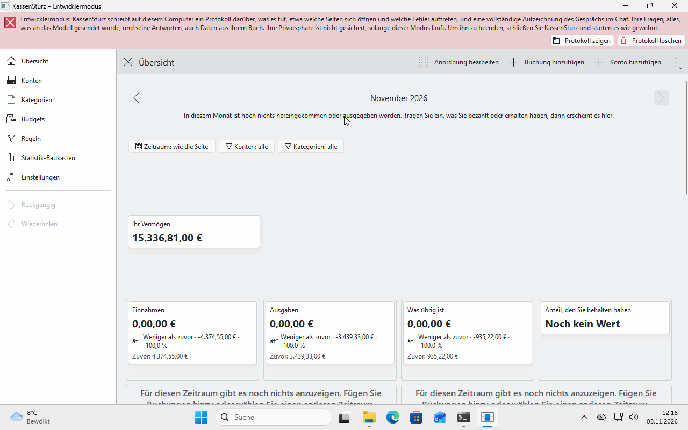

# 4. The overview and your dashboards

*The overview is KassenSturz's start page. This page explains what it shows, how to look at other months and how to make your own pages with charts and figures.*

## What the overview shows

- What all your accounts hold **together** today.
- For one month: **Money in**, **Money out** and what is **Left over**. If more went out than came in, it says so instead.
- **Where your money went** and **Where your money came from**, by category, the biggest first. Anything you haven't put into a category yet is under **Not sorted yet**.
- If you have set budgets, their bars appear too (page 13). Without a budget they take up no space.
- If an account connected to your bank hasn't been fetched for a long time, the overview warns you with the account's name and the day (page 11).

## Looking at other months

With the **arrows next to the month's name** you go back as far as your book has transactions, and forward up to the current month, or further if you entered something for a later month. **Back to this month** takes you to the current one.

## What doesn't count

- **Money you move between your own accounts** is neither money in nor money out (page 8). A fee for it counts as money out.
- **Starting balances** don't count either.
- **Several currencies:** each currency has its own accounts, totals and categories. KassenSturz never adds euros and dollars together.

## Your own dashboards

A **Dashboard** is a page you put together yourself: charts, tables, number cards and budget bars. The overview is the first dashboard.

- **New dashboard…** in the overview's menu makes a second page. It starts empty, with the menu for adding already open. **Done** keeps the page.
- **Tabs:** as soon as you have two dashboards, tabs appear at the top. **Ctrl+Page Down** and **Ctrl+Page Up** go to the next and the previous one.
- **The dashboard menu** (from two dashboards on) renames, copies, moves and deletes the dashboard you are looking at. **Make this the default** sets which one your book opens with; its tab shows a small house. As long as you set nothing, the book opens with the overview.
- **Edit layout** lets you add, move and remove items. **Add to the page** puts an item on the page; **Properties** opens an item's settings (period, accounts, categories, colours). **Done** saves the layout.
- **Save as a new dashboard…** keeps the page you are arranging as an extra dashboard.
- **Save this dashboard to a file** and **Add a dashboard from a file** pass a dashboard on to another book. The file holds **no amounts, transactions or account numbers**, only the names of the accounts and categories.
- Each of these steps is a change that **Undo** takes back.

## A page's filter

Above the items is the **Filter bar**: period, accounts and categories apply to every item that follows the page. **Reset filters** counts everything again. An item can also have its own filter in its **Properties**; a grey filter note then says what it counts. In **Settings** you can hide the grey notes (**Hide the grey filter notes**).

A period can also move with today's date, for example **The last months…** or **A salary month…** (page 14), so a chart never goes out of date.

**If something looks different:** the items you see on your overview depend on your book. An example book such as *Flower Utopia* shows more of them than a new book.
