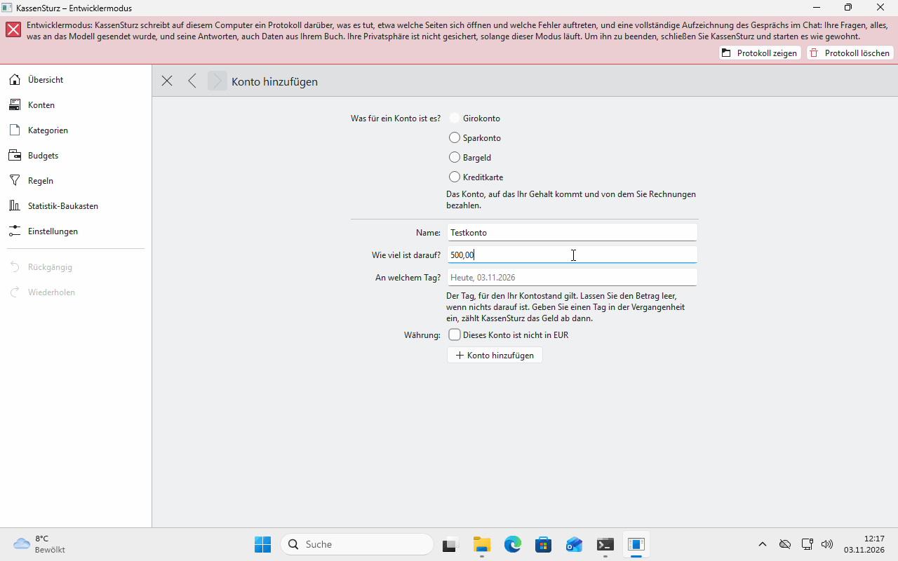

# 5. Accounts

*An account is a place where your money is. This page shows how to add accounts, look at them, check them against your bank and close them.*

## The accounts page

**Accounts** in the menu on the left shows your accounts side by side with what is in each. A credit card reads "You owe …". From two accounts on, **All together** shows what you have minus what you owe.

## Kinds of account

Checking account, savings account, cash and credit card. Each account has one currency. You add an account in another currency later when you need one (page 7).

## Adding an account

1. On the accounts page, choose **Add account**.
2. Choose the **kind**, give it a **name**, the **Amount** that is in it today, and the day. Take the amount from your banking app or your bank statement, so KassenSturz starts from what is really there. To practise, you may make one up.

## Opening an account

Click the account's card. You see all its transactions, the newest first, and next to them what was in the account after each one ("Then: €946.80"). How to enter them is on page 7.

At the top right, under **About this account**, you can:

- **Rename** the account,
- **Check against my bank**,
- **Close account**.

## Check against my bank

Type what your bank gives as the balance on a day. KassenSturz says whether it agrees. If not, it shows the difference exactly to the cent and names possible reasons: a transaction that is in twice or missing, a wrong starting balance. **It changes nothing by itself.** If your starting balance is wrong, it offers to correct it; only you do that.

## Closing an account

You can close an account when nothing is left in it, for example a card your bank replaced. Its history is kept; it just takes no new transactions and disappears from the lists. **Show closed accounts** lists it again, and you can open it again.

## Accounts and your bank

If an account is linked to a bank account, the accounts page says so, with the day it was last fetched (page 11).

**If something looks different:** an account's balance is always the sum of its transactions. If it doesn't agree with your bank, **Check against my bank** helps you find out why.
