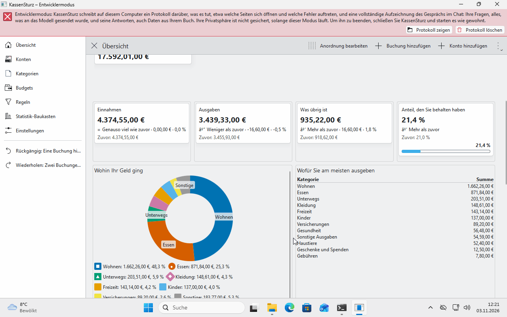

# 6. Categories and category groups

*Categories say what you spent money on and where it came from. This page shows how to look at them, change them and group them.*

## The tree

**Categories** in the menu on the left shows where money comes from and what it is spent on, as a tree. A category can sit inside another one, for example *Groceries* inside *Food*, as deep as you like.

At the start, KassenSturz makes categories for you (money in, such as Salary; money out, such as Home, Food, Health). They are yours; you may rename, move and add to all of them.

## Adding, changing and moving a category

- **Add category** makes a new one. It is either for money you receive or for money you spend.
- Click a category to **rename** it or **move** it.
- If you change the name, the category changes in all its transactions too; the transactions themselves stay as they are.
- You can delete a category only when it has no transactions left; KassenSturz tells you to put them into another category first. A category for money in belongs only inside another one for money in, and a category for money out only inside one for money out.

## "Not sorted yet"

A transaction without a category shows as **Not sorted yet**. That is allowed, and the overview shows it separately. Rules (page 12) sort new transactions by themselves; you sort the rest on the transaction's page.

## Category groups

A **category group** brings together categories that are not on the same branch, for example "Fixed costs" made of rent, electricity and insurance. Groups change no transaction; they are a selection you can use in charts, filters and budgets (pages 13 and 14).

## Several currencies

Each currency has its own category totals. A category that counts in another currency, for example *Travel* in dollars, is listed with what you paid from your account.

**If something looks different:** the names in the tree are suggestions. If they don't suit you, change them; none of them is fixed.
