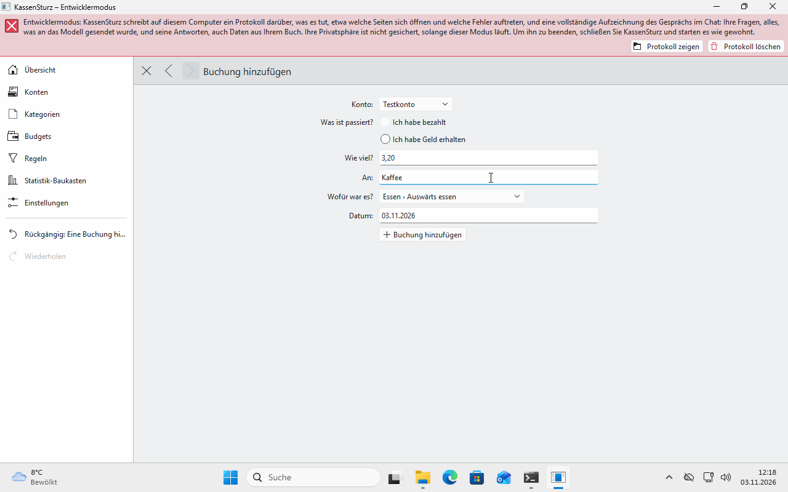
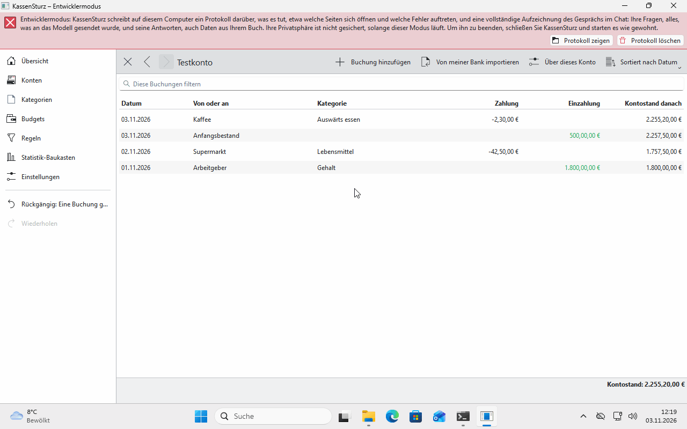

# 7. Entering, changing and breaking down transactions

*A transaction is one payment or deposit. This page shows how to enter one, find it again, change it, break it down into parts and enter it in another currency.*

## Entering a transaction

1. Open the account and choose **Add transaction**.
2. Say what happened: **I paid money** or **I received money**. Then: **how much**, **from or to whom**, **what for** and **when**.
3. Type amounts the way your Settings show them, in English for example `53.20`.
4. **Not sorted yet** leaves the category open; you can sort it later.
5. Save. A message says what was done, with an **Undo** button.

## An account's list

- **Sorted by** orders the list by date, amount, name or category.
- **Filter these transactions** shows only transactions that contain **all** your search words. If nothing matches, it says "Try other words"; clear the field to see all of them again.
- For transactions from your bank, the details show what the bank delivered (**As delivered**), for example the purpose and the value date. Your own changes, such as a clearer name or the category, sit on top of that.

## Changing and deleting

Click a transaction to change it. **Delete** takes it out of the list and out of the balance. **Undo** brings it back (page 9).

## Breaking down a transaction

One bill at the supermarket can be partly groceries and partly household goods.

1. Open the transaction and choose **Break down this transaction**.
2. Add **parts** (**Add a part**) and say for each what it was for.
3. One part may stay without an amount; KassenSturz works out the rest.
4. Together, the parts must make up the whole transaction. If they don't, the page says by how much they are off.

You can do this at any time, not only when reading in a statement.

## In another currency

A part in another currency keeps its **original amount**. KassenSturz also remembers the **exchange rate**, the day and the source used to convert the amount into the transaction's currency. If your book has no exchange rate for that day yet, type what the part was in that currency, for example from the receipt. You enter exchange rates by hand; KassenSturz doesn't fetch any from the internet.

A transaction always balances **in one currency**. If KassenSturz ever rounds, for example in a conversion, the rule for it is in Settings and applies only to future calculations.

**If something looks different:** if an amount isn't accepted ("This isn't an amount"), type it the way the message shows it, in English for example `1,234.56`.
