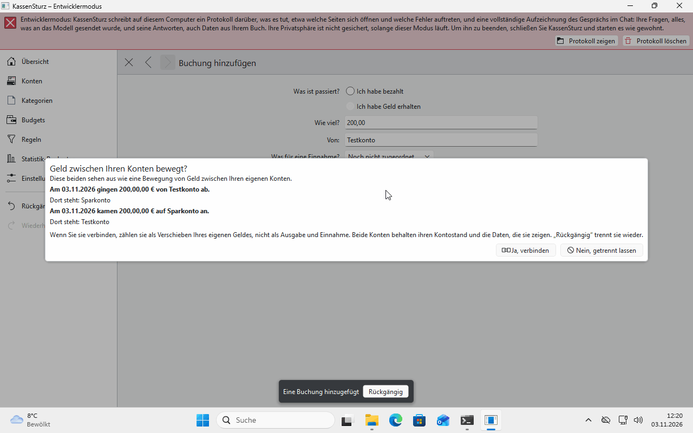
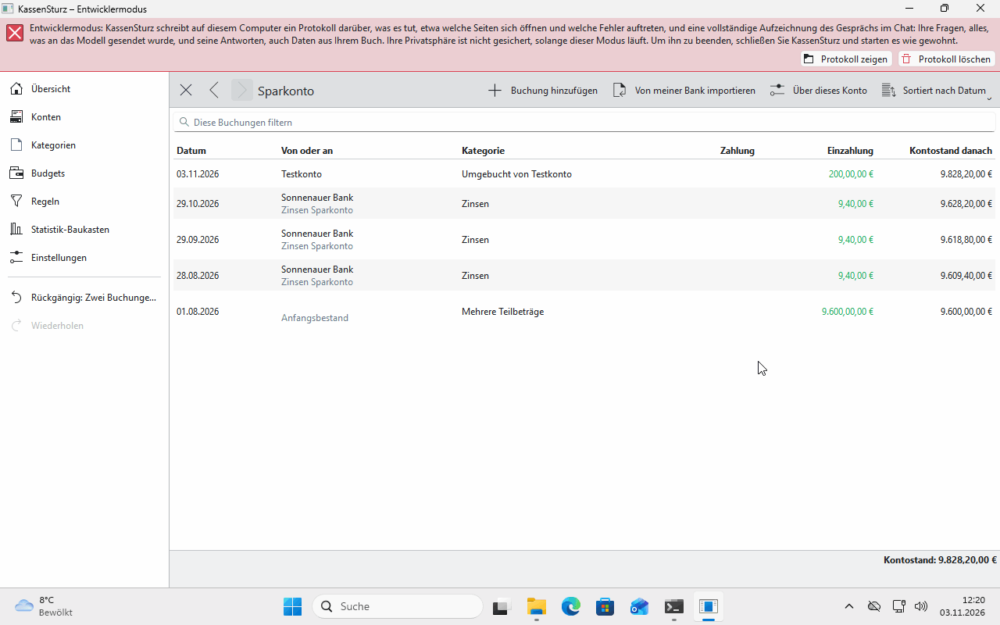

# 8. Moving money between your own accounts

*When you move money from one of your accounts to another, it is neither money out nor money in. This page shows how KassenSturz notices this and how you join the two sides yourself.*

## The example

You move €200 from your checking account to your savings account.

1. In the checking account, enter **I paid money** €200, and in the savings account **I received money** €200, both with **Not sorted yet**.
2. After the second transaction, KassenSturz asks: **Money moved between your accounts?** Answer **Yes, join them**.

The two transactions are now one **Transfer**. On the overview it counts neither as money in nor as money out.

## When does KassenSturz ask?

The two sides must:

- be for **the same amount**,
- be in **the same currency**,
- be **at most three working days** apart,
- be in **different accounts**.

If you say **No**, the transactions stay separate. The same goes for reading in bank data: KassenSturz suggests matching pairs there too.

## Separating them again

**Undo** separates a joined pair again; the two transactions stay as single payments.

## Fees

A fee charged for a transfer is spending like any other and counts as money out.

**If something looks different:** if KassenSturz doesn't ask, one of the four conditions isn't met, usually the amount or the number of days between them.
