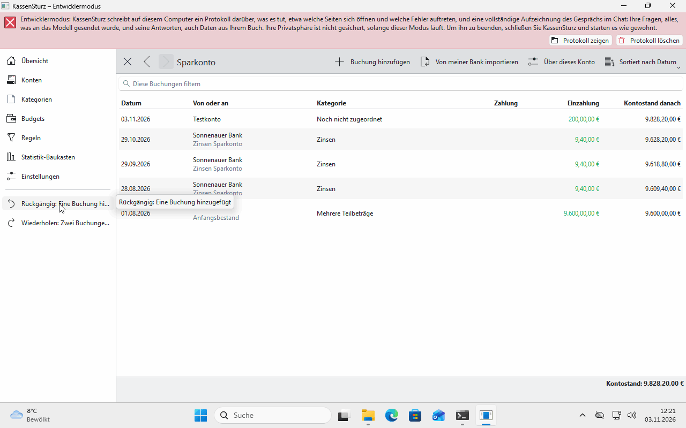

# 9. Undo, redo and the history

*Nothing you change is beyond taking back. This page explains how.*

## Undo and Redo

- **Undo** and **Redo** are in the menu and on **Ctrl+Z** and **Ctrl+Shift+Z**.
- They say what they do, for example "Undo: Removed a transaction".
- Undo always takes back **the newest change**, even after you closed the book and opened it again.

## The history

In **Settings**, **Show history** shows the last 100 changes with day and time. KassenSturz keeps the history for 30 days unless you choose otherwise. You set how long in Settings.

## Cleaning up the history

**Clean up history…** deletes the whole history for good, also from the file. **After that, nothing done so far can be undone anymore.** KassenSturz says so first and asks you to confirm.

## Backups

Before it adapts a book to a new version, KassenSturz makes a **backup** of the whole book by itself (**Settings › Backups**) and keeps the last ten.

**If something looks different:** after a message such as "Undo can only bring the transaction back until you close this book", your Settings keep no history. You can switch it on there.
