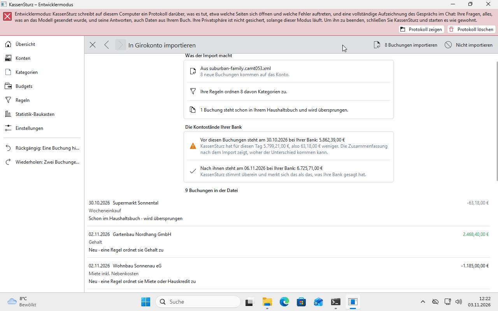
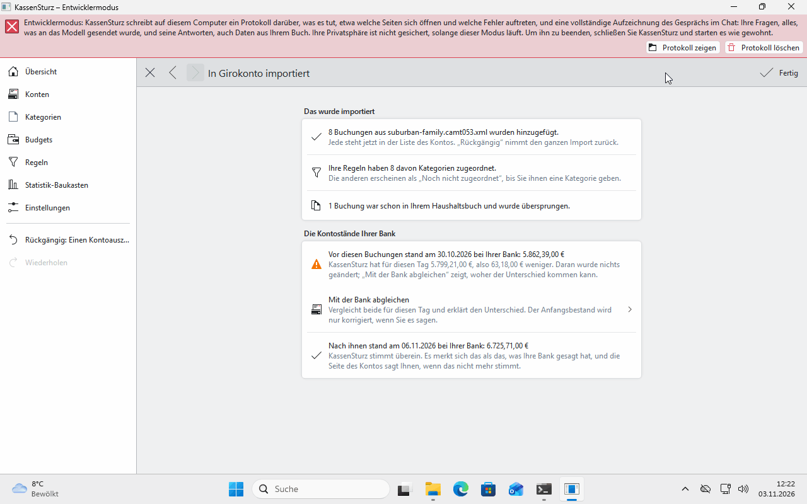

# 10. Reading in a bank statement

*Instead of typing every transaction, you read in a file from your bank. This page shows the way, and what the preview tells you before anything happens.*

## Which files work

In your online banking, download a statement as:

- **CAMT.053** (`.xml`),
- **MT940** (`.sta`),
- **OFX** (`.ofx`) or
- **CSV** (`.csv`, `.txt`).

These are four ways a bank can write a statement into a file; the letters in brackets are the file ending. If your bank offers several, take the first one in this list that it has: the first three are read without further questions, and CSV is there for banks that offer nothing else. A statement as a PDF, the kind you print, can't be read in.

**Where to find it:** sign in to your bank's website and open the account. Look for a button named something like **Export**, **Download** or **Save transactions**, choose the period and one of the kinds above. Your browser puts the file into your **Downloads** folder unless you choose another place. Every bank names this a little differently; if you can't find it, the bank's help pages or hotline know it as "exporting transactions".

## The way

1. In KassenSturz, open the matching account.
2. Choose **Import from my bank** and the file.
3. For a **CSV file**, KassenSturz asks how to read it: separator, columns, date format and the like. The preview shows straight away whether your choice is right. It is remembered for the next file from the same bank.
4. Read the **Preview** (below).
5. **Import**, or **Don't import**.

## The preview

It tells you, **before anything happens**:

- how many transactions are **new**,
- how many are **Already in your book**; they are not taken over twice,
- how many are **Maybe in your book already**, because they look like a transaction you have (the same amount, a few days apart). They are taken over only if you say so (**Import it anyway, it is a different transaction**); below them you see what makes them different,
- how many are **Twice in the file** and count only once,
- how many are **Not booked by your bank yet**; the import leaves them out, and they come with a later statement,
- how many your **Rules** sort straight away,
- for Transfers: which pairs KassenSturz found (page 8).

If you close the preview, nothing changes.

### The first import into an account

You entered the account's balance for a day, usually today. The first file or the first fetch from your bank mostly brings the transactions from *before* that day. So that they don't change your balance a second time, KassenSturz works out what the account held before the first of them, from the balance your bank gives (or, if the file has none, from the balance you entered). The preview says so under **Starting balance**, with the amount and day before and after. Your balance stays what your bank says, and **Undo** takes this back together with the import.

This happens only with the first import into an account. Later, KassenSturz never changes the starting balance by itself; if the figures differ, **Check against my bank** shows why (page 5).

## Afterwards

KassenSturz compares the account's balance with the file's and says whether they agree. **Undo** takes back the whole import as one step.

KassenSturz never rounds or guesses here: an amount it can't read exactly stops the import, and nothing is taken over.

**If something looks different:** if the file has very many entries, KassenSturz asks you to download a shorter period and read in the parts one after another.
