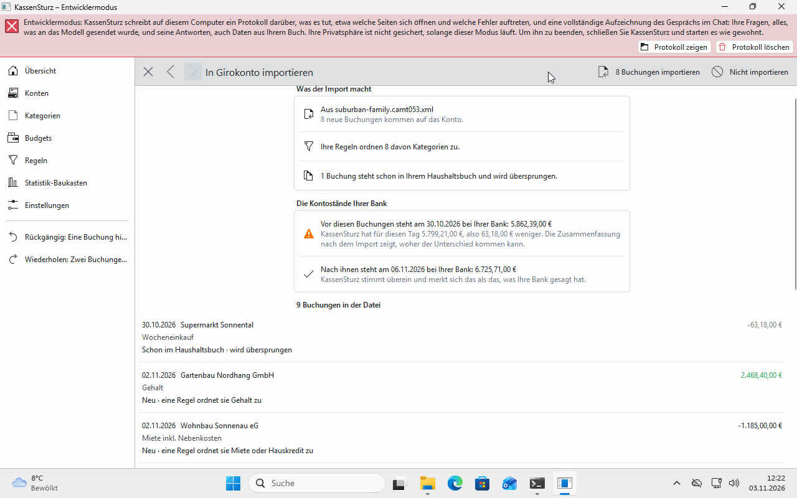
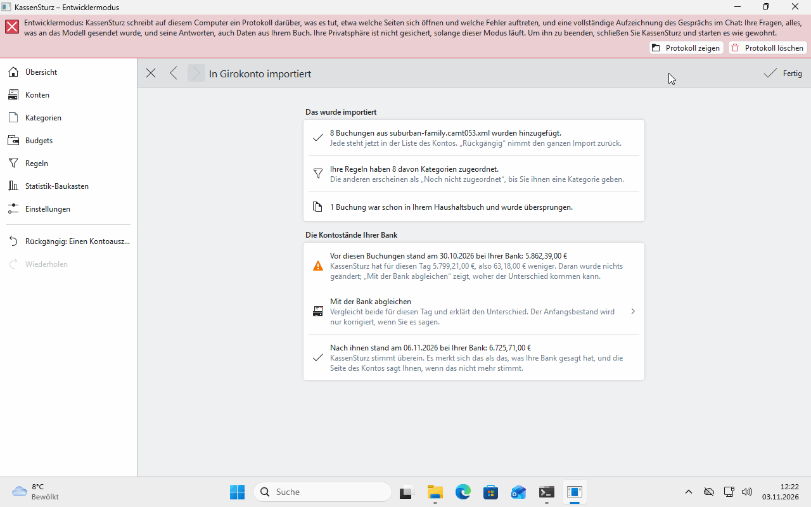

# 10. Reading in a bank statement

*Instead of typing every transaction, you read in a file from your bank. This page shows the way, and what the preview tells you before anything happens.*

## Which files work

In your online banking, download a statement as:

- **CAMT.053** (`.xml`),
- **MT940** (`.sta`),
- **OFX** (`.ofx`) or
- **CSV** (`.csv`, `.txt`).

## The way

1. In KassenSturz, open the matching account.
2. Choose **Import from my bank** and the file.
3. For a **CSV file**, KassenSturz asks how to read it: separator, columns, date format and the like. The preview shows straight away whether your choice is right. It is remembered for the next file from the same bank.
4. Read the **Preview** (below).
5. **Import**, or **Don't import**.

## The preview

It tells you, **before anything happens**:

- how many transactions are **new**,
- how many are **Already in your book**; they are not taken over twice,
- how many are **Maybe in your book already**, because they look like a transaction you have (the same amount, a few days apart). They are taken over only if you say so (**Import it anyway, it is a different transaction**); below them you see what makes them different,
- how many are **Twice in the file** and count only once,
- how many are **Not booked by your bank yet**; the import leaves them out, and they come with a later statement,
- how many your **Rules** sort straight away,
- for Transfers: which pairs KassenSturz found (page 8).

If you close the preview, nothing changes.

## Afterwards

KassenSturz compares the account's balance with the file's and says whether they agree. **Undo** takes back the whole import as one step.

KassenSturz never rounds or guesses here: an amount it can't read exactly stops the import, and nothing is taken over.

**If something looks different:** if the file has very many entries, KassenSturz asks you to download a shorter period and read in the parts one after another.
